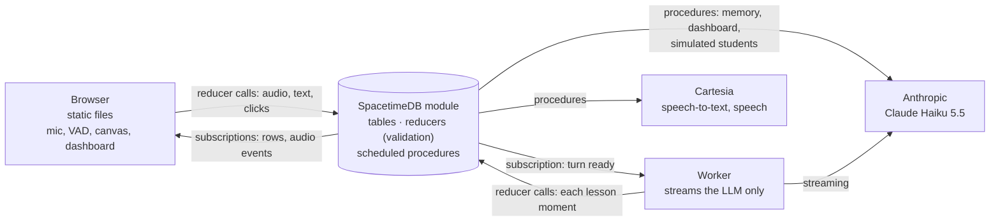

<p></p>

# Fibonacci

A voice math tutor on SpacetimeDB.

## For judges

**Fibonacci — a voice math tutor for children aged 8–12 who are stuck on fractions homework.**

**Who and what.** For children aged 8–12 (3rd–6th grade) who are stuck on fractions or decimals
homework and have nobody at home who can explain *why* (why 1/4 + 2/4 is not 3/8). The child talks
to a tutor and can add a photo of the task. The tutor explains with a picture that changes on the
word it is saying: first an intuitive picture, then the notation, then a similar task the child
solves alone. At the end it hands the child's own homework back without solving it. Teachers can
run a whole class: every student joins a live session with the teacher's goals, and the teacher
sees an AI summary, groups of students who are stuck the same way, and any student's screen live.
Speech is Cartesia (Ink STT, Sonic TTS). The LLM is Claude Haiku 5.5. The whole backend is one
SpacetimeDB module. Test users only: no real children have used it yet.

Reviewer index with evidence per criterion (file:line, routes, measured numbers):
**[docs/JUDGING.md](docs/JUDGING.md)**. Devpost text: [docs/DEVPOST.md](docs/DEVPOST.md).

### Where to look, by track

| Track | Look here |
| --- | --- |
| **Cal Hacks general** | Pitch (60 s / 3 min) and judge Q&A: [docs/PITCH.md](docs/PITCH.md) · live demo script: [docs/DEMO.md](docs/DEMO.md) · screens: [docs/screenshots/](docs/screenshots/) (`11-student-voice-speaking.png`, `24-dashboard-odd-class.png`, `15-observe-frame.png`) · [Known limitations](#known-limitations) · [What's real vs simulated](#whats-real-vs-simulated) |
| **Cartesia: Best Use of Cartesia** | [Cartesia features used](#cartesia-features-used) (models, voice id, call sites) · per-turn latency (end of speech → first audio) in the session's debug panel, read from `turn_metrics` · [docs/latency-internal.md](docs/latency-internal.md) · edge cases (barge-in, noise floor, Smart Turn, speech normalizer): [docs/SERVICES.md](docs/SERVICES.md) · [STT decision](#stt-decision-spacetimedb-calls-cartesia-through-a-local-batch-proxy) |
| **SpacetimeDB: Best Use of Spacetime** | [How SpacetimeDB is used](#how-spacetimedb-is-used) · every table and reducer: [docs/ARCHITECTURE.md](docs/ARCHITECTURE.md) §2–3, why it is idiomatic §11 · live shared state: `?observe=<id>` (teacher watches a student's live screen), `?overview` (all sessions), `?class=<id>` (dashboard) · classroom and simulated students: [docs/CLASSROOM.md](docs/CLASSROOM.md) |
| **Anthropic: Claude for Public Benefit** | [How Claude is used](#how-claude-is-used) (model id, structured outputs, guards) · [Responsibility & privacy](#responsibility--privacy) · what can go wrong and what the code checks: [docs/JUDGING.md](docs/JUDGING.md#anthropic-claude-for-public-benefit) · effort and thinking measurements: [docs/SERVICES.md](docs/SERVICES.md), [docs/CLASSROOM.md](docs/CLASSROOM.md) |

### Setup in 5 commands

Root `.env` (git-ignored) needs two key **names**: `CARTESIA_API_KEY` and `ANTHROPIC_API_KEY`
(template: [.env.example](.env.example); OpenRouter is optional). Needs Node ≥ 22.12, pnpm 9, the
`spacetime` CLI 2.13 and Chrome for voice. More options: [Quickstart](#quickstart).

```bash
curl -sSf https://install.spacetimedb.com | sh   # spacetime CLI (once)
cp .env.example .env                             # then fill in CARTESIA_API_KEY and ANTHROPIC_API_KEY
pnpm install
pnpm dev:voice                                   # local SpacetimeDB + publish + worker + client on http://127.0.0.1:5175
node scripts/seed-demo.mjs                       # demo students and teachers (Ava Chen, Ms. Park, ...)
```

### Architecture



Browser and worker only talk to SpacetimeDB. SpacetimeDB calls Cartesia and Anthropic itself. The
worker streams the model and nothing else ([why](#why-a-worker-exists)). Full design:
[docs/ARCHITECTURE.md](docs/ARCHITECTURE.md).

### Cartesia features used

| Feature | Model / setting | Where it is called |
| --- | --- | --- |
| Text-to-speech, one request per sentence | **Sonic `sonic-3.6`** via `POST https://api.cartesia.ai/tts/sse` with `add_timestamps: true` (word timings drive the canvas keyframes), raw `pcm_s16le` 24 kHz, `Cartesia-Version: 2026-08-14` | `spacetimedb/src/providers.ts:126-160`, from the scheduled procedure `synthesizeSentence` (`tts_job`, `spacetimedb/src/voice_out.ts`) |
| Tutor voice | "Parker", voice id `30894953-bcce-41fe-892c-15ce19c843ff` | `shared/src/config.ts:87` |
| Speech-to-text, one request per phrase | **Ink `ink-whisper`** via batch `POST /stt` (default, works out of the box). **`ink-2`** only through our `stt-proxy` on a public host: ink-2 is websocket-only and procedures can't open websockets ([STT decision](#stt-decision-spacetimedb-calls-cartesia-through-a-local-batch-proxy)) | `spacetimedb/src/providers.ts:85`, from the scheduled procedure `transcribePhrase` (`stt_job`, `spacetimedb/src/voice_in.ts:205`) |
| Test-student speech (E2E tests only) | Voice "Daisy" `32b3f3c5-7171-46aa-abe7-b598964aa793`: generated audio fed to a fake microphone in headless Chrome | `shared/src/config.ts`, `e2e/` |

Around Cartesia: phrases are transcribed while the child is still talking, so only the last
phrase's STT falls inside the turn-end wait; barge-in (`interrupt` reducer, `playback_flush` event)
cuts the tutor off mid-sentence; a speech normalizer turns `3/4` into "three quarters" before TTS
(`shared/src/normalizer.ts`). **Measured** (local server, real Haiku + Cartesia): end of speech →
first tutor audio p50 2.75 s (min 2.62, max 3.17; final E2E 8/8, [NIGHT_REPORT](docs/NIGHT_REPORT.md));
one live turn: STT done +0.45 s, first audio +2.77 s. Every turn's timestamps are a `turn_metrics`
row, shown in the session's debug panel (on by default, `?debug=0` hides it).

### How SpacetimeDB is used

One TypeScript module (`spacetimedb/`) is the whole backend; the client is static files. Full
inventory: [docs/ARCHITECTURE.md](docs/ARCHITECTURE.md) §2–3, §10–11.

- **Public tables (subscribed):** `session`, `phrase`, `turn`, `reply_sentence`, `board_item`, `beat`, `canvas_state`, `lesson_state`, `turn_metrics`, plus classroom tables (`class_session`, `presence`, `class_summary`, `student_cluster`, `dashboard_state`). Each screen subscribes only to its own session's rows (`client/src/stdb/useSessionData.ts:28-39`).
- **Private tables (no client can subscribe):** `audio_in` (mic chunks), `session_image` (photo), `memory_note`, `note_evidence`, `concept_state`, `session_summary`, `lesson_record` and `board_answer` (answer keys), `class_document`, `role`.
- **Event tables (delivered at commit, never stored):** `audio_out` (PCM + word timestamps per sentence), `playback_flush` (barge-in), `speech_activity`.
- **Reducers:** every write and every check. `pushAudio`, `endTurn`, `submitTextTurn`, `interrupt`; the worker's `beginLesson` / `addBeat` (each lesson moment is compiled against the live `canvas_state` and rejected with `SenderError` if it doesn't fit); `startClassSession`, `setPresence`, `setImpersonation`.
- **Procedures (`ctx.http.fetch`):** `transcribePhrase` and `synthesizeSentence` (Cartesia); `extractMemory`, `summarizeSession`, `simStudentTurn`, `dashboardTick` / `refreshDashboard` (Claude, structured outputs); agent-only `buildLessonRequest` / `buildContext` (the only way memory reaches the model).
- **Schedule tables instead of queues:** `stt_job`, `tts_job`, `text_play_job`, `extraction_job`, `summary_job`, `sim_turn_job`, `dashboard_job`. Retries are new rows; cancelling is a delete.
- **Subscriptions are the product:** the teacher's observe frame (`?observe=<id>`) is the student's own view component on the same subscription, read-only; `?overview` lists every active session; the worker is just another subscriber, registered as `agent`.
- **Why a worker exists:** a procedure's `ctx.http.fetch` is synchronous and returns the whole response, so it can't read a token stream. Async procedures are proposed in [SpacetimeDB#4697](https://github.com/clockworklabs/SpacetimeDB/issues/4697). The worker only streams Claude and proposes moments; the module decides. [Details](#why-a-worker-exists).
- **Better than naive audio-over-DB:** mic audio goes up as binary reducer arguments (160 ms chunks = 5,120 B with 45 B overhead each, no base64; `AUDIO_CHUNK_MS: 150` rounded up to whole VAD frames) into a **private** table, read through a btree index on `(sessionId, phraseId)` (`spacetimedb/src/schema.ts:73-86`) and **deleted right after transcription** (`spacetimedb/src/voice_in.ts:189`). Tutor audio comes back as **event rows**, one per sentence, so nothing is stored. Every subscription is filtered by `session_id`. Reducer round trip p50 8.1 ms; our own overhead per voice turn p50 101 ms ([docs/latency-internal.md](docs/latency-internal.md)).

### How Claude is used

- **Model and provider:** Claude Haiku 5.5, model id **`claude-haiku-5-5`**, called directly through the Anthropic Messages API (`worker/src/env.ts:84`, `shared/src/config.ts:73`). OpenRouter is only a fallback path and is not used in the demo.
- **Tutor (worker, streaming):** the team's lesson planner streams a compact lesson JSON; each moment goes to the module as soon as it is complete (`worker/src/lesson.ts`). Thinking off, `effort: low` (measured: same latency as medium, fewer failures), cached system prompt. Deadlines: first token 9 s (retried once), 45 s total, 15 s stall.
- **Lesson arc:** authored opening (no LLM, ~0.5 s) → visual intuition → formalization (the equation appears on the sentence that reads it) → one task with different numbers → the child's own homework handed back. A wrong, unclear or "I don't know" answer gets one smaller repair step first. Allowed phases are checked by the module. [ARCHITECTURE §6–7](docs/ARCHITECTURE.md).
- **Inside SpacetimeDB procedures** (structured outputs via `output_config.format` JSON schema, raw HTTP in `spacetimedb/src/anthropic.ts`): memory notes and mastery estimates every 6 turns, session summaries, simulated students' messages, the dashboard's class summary and groups.
- **Guards that exist in code** (gaps and details: [docs/JUDGING.md](docs/JUDGING.md#anthropic-claude-for-public-benefit)):
  - *Wrong math:* number checks carry an arithmetic rule (`{operation, left, right}`) that code evaluates; the child's answer is graded in code by `assessResponse` (`teaching/src/teaching/checks.ts:118`, `source: "deterministic"`) for numbers, choices, canvas placements and edited picture values. Equations on the canvas are computed by the compiler from the shown quantities.
  - *Invalid pictures:* every moment is compiled against the live canvas in the `addBeat` reducer (`spacetimedb/src/pipeline.ts:278`); one repair round, otherwise a recap.
  - *Giving away the homework:* the module rejects a check that contains the child's original question (`spacetimedb/src/pipeline.ts:246-249`; a substring match, so a paraphrase passes).
  - *Bad groups:* dashboard group sizes are repaired to 2 or 4 in code (`repairClusters`, `spacetimedb/src/classroom.ts:744`).
  - *Unsure memory:* notes below confidence 0.7 are dropped (`spacetimedb/src/memory.ts:219`).
  - Tone, length, staying on topic and not asking for personal data are **prompt-only** (see [Known limitations](#known-limitations)).

### Responsibility & privacy

- **Test users only.** No accounts, no real children's data, not compliance-reviewed. Demo users are fictional (`scripts/demo-seed.json`).
- **Raw mic audio** (`audio_in`, private) is deleted as soon as its phrase is transcribed (`spacetimedb/src/voice_in.ts:189`) and when the session ends (`spacetimedb/src/sessions.ts:89`). Tutor audio is never stored (event table).
- **Kept until the database is cleared** (no automatic expiry): transcripts (`phrase`, `turn`, `reply_sentence`: public tables, readable by any connected client because there is no auth), the task photo (`session_image`, private, max 1 MB), memory notes, evidence quotes and mastery estimates (private; they reach the model only through agent-only procedures, and a **teacher** only through the teacher-gated `learnerInsights` procedure behind the dashboard's "Profile" panel — never a student screen; without auth anyone who knows a teacher id can call it, optionally locked with `INSIGHTS_KEY`, acceptable for test users only). Simulated students' sessions are deleted when they are reset.
- **Sent to third parties:** audio and tutor text to Cartesia; transcripts, the task, the photo and memory notes to Anthropic.
- **Keys** live only in the module env and the worker's `.env`, never in tables or in the browser. The local `.spacetime-data/` holds the module env in plain bytes and is git-ignored.

### Known limitations

- Not tested with real children, on real devices or with loudspeakers (headphones recommended; echo can trigger barge-in).
- All numbers were measured on one laptop against a **local** SpacetimeDB 2.13. Maincloud is supported by the publish script but not migrated or measured.
- Cloud plan (not started): Maincloud migration, then a per-turn Cloudflare Worker replacing the Node LLM worker, in [docs/CLOUD_PLAN.md](docs/CLOUD_PLAN.md).
- Procedure slots: the local server runs ~10 procedures at once and an HTTP wait holds a slot; with 4 parallel voice sessions TTS jobs waited up to 0.7 s. Simulated-student calls are capped at 4 in flight.
- STT defaults to `ink-whisper`; `ink-2` needs the proxy on a public host.
- Word budgets, tone, staying on topic and not asking for personal data are prompted, not enforced; explanations often run over budget (107–150 words). The spoken math in the narration is not formally checked.
- The "not your own homework" check is a substring match. The dashboard can put a student in a group without evidence.
- No auth: any client can subscribe to public tables (transcripts, dashboard). The dashboard for 8+ students takes 7–10 s per refresh.

### What's real vs simulated

| Real | Simulated or authored |
| --- | --- |
| Cartesia STT and TTS, Claude Haiku 5.5, every reducer and procedure, memory, dashboard, observe | Classroom students: 1–20 simulated students (personas in `shared/src/classroom/simStudents.ts`) whose messages Claude writes; they talk to the real tutor in **text mode** |
| The voice lesson in the demo (a person speaking) | The tutor's opening line is authored, not generated |
| Latency numbers from `turn_metrics` and E2E runs | E2E "students" are Cartesia-generated speech fed to a fake microphone |
| | Demo users and their seed memory (`scripts/demo-seed.json`) |

---

## About the project

Fibonacci is a voice math tutor for children aged 8–12. A student talks (or types) about the task they are stuck
on, optionally with a photo, and the tutor explains it with moving pictures that change exactly when
the tutor says the matching words: first an intuitive picture, then the formal notation, then a task
the student solves themselves. Teachers can run a whole class: every online student joins a live
session with the teacher's goals and teaching instructions, and the teacher follows the class on a
dashboard with AI summaries and groups of students, and can watch any student learn live.
Simulated students make the classroom demo-able with one laptop.

Built for CalHacks 2026. SpacetimeDB is the backend and the only data path: state,
validation, speech-to-text, text-to-speech, memory and the teacher dashboard all run in the module;
the browser client is static files; a small worker exists only to stream the LLM.

Test users only. Never use real children's data.

## Features

- **Self-learning by voice**: "Learn by myself" with a task description and an optional photo;
  microphone and sound start with the lesson (browser VAD + semantic turn detection, barge-in);
  a gear menu picks microphone / speaker and sets the microphone boost and tutor volume.
- **Lesson arc**: the team's teaching methodology (intuition → formalization → solving) planned by
  Claude Haiku 5.5 and streamed moment by moment; every moment is compiled and validated by
  SpacetimeDB against the live canvas, with a repair round or a recap when the model slips.
- **Live canvas keyframed to speech**: each lesson moment appears when the tutor starts the sentence
  that describes it; checks (choices, "check my picture", free answers) follow the explanation.
- **Tutor avatar**: listens, thinks (visible while the reply is being planned) and speaks with
  mouth movement driven by the audio.
- **Memory**: every few turns the conversation is distilled into private notes and mastery
  estimates that shape the next lessons.
- **Teacher classroom**: learning goals, content, delivery instructions and an optional document
  (image or Markdown); starting a class pulls every waiting or learning student into it; late
  joiners join automatically.
- **Simulation**: 1–20 realistic simulated students (personas, typical misconceptions, seed memory)
  talk to the real tutor in text mode.
- **AI dashboard**: class summary and groups of exactly 2 or 4 similar students with a short status,
  refreshed every 30 s or on demand.
- **Observe / impersonate**: hover a student → Observe → the student's live screen (transcript +
  canvas) in a frame with previous / next; the dashboard pauses its refresh while you watch.

## Quickstart

Requirements: Node ≥ 22.12, pnpm 9, the `spacetime` CLI 2.13 (`curl -sSf https://install.spacetimedb.com | sh`),
Chrome or another Chromium browser for voice.

Root `.env` (git-ignored; see `.env.example`):

```bash
CARTESIA_API_KEY=...          # TTS + STT
ANTHROPIC_API_KEY=...         # Claude Haiku 5.5: worker, memory, dashboard, simulated students
# OPENROUTER_API_KEY / OPENROUTER_MODEL: optional fallback LLM, only needed without ANTHROPIC_API_KEY
STT_BASE_URL=https://api.cartesia.ai   # recommended for local runs (see "STT decision")
CARTESIA_STT_MODEL=ink-whisper
```

`AGENT_SECRET` is generated into `.env.local` on the first publish.

```bash
pnpm install
pnpm dev:voice                # everything: SpacetimeDB, publish, bindings, stt-proxy, worker, client
                              # (pnpm dev:voice -- --clear resets the database)
# or step by step:
pnpm stdb:start               # terminal 1: local SpacetimeDB on 127.0.0.1:3000, data in ./.spacetime-data
pnpm stdb:publish             # publish the module (database voice-tutor), keys as module env
pnpm worker                   # terminal 2: LLM worker
pnpm dev                      # terminal 3: client on http://127.0.0.1:5175
```

Demo data and a class from the command line (local server only; `SPACETIME_DB=<name>` for another
database; details in [docs/DEMO.md](docs/DEMO.md)):

```bash
node scripts/seed-demo.mjs                   # demo students + teachers (scripts/demo-seed.json) and their
                                             #   seed memory (agent-only seedMemory, AGENT_SECRET from .env.local)
node scripts/simulate.mjs --preset A --n 6   # start a simulated class (presets A/B/C), prints ?class=<id>
node scripts/simulate.mjs --end              # end it; --no-reset keeps sim memories, --reset-only resets them
```

`pnpm dev` starts only the client. `pnpm stdb:generate` regenerates the client and worker bindings
after a schema change. `pnpm stt-proxy` runs the local ink-2 proxy (only useful once it is reachable
by SpacetimeDB, see below). If your machine has a system HTTP proxy, local tools need
`NO_PROXY=127.0.0.1,localhost`; the scripts set it.

### Routes (all on http://127.0.0.1:5175)

| URL | Screen |
| --- | --- |
| `/` | Entry: "I'm a student" / "I'm a teacher" |
| `?student`, `?student=<id>` | Pick or create a student; then "Learn by myself" (task + photo, voice or typed) or "Wait for my teacher" |
| `?wait=<id>` | Waiting room; jumps into the class session when the teacher starts one |
| `?session=<id>` | The lesson: avatar, canvas, transcript, mic or text input |
| `?teacher`, `?teacher=<id>` | Pick or create a teacher; class setup (goals, content, how to teach, material, simulated students) |
| `?class=<id>` | Teacher dashboard (summary, groups, observe, all sessions, end class) |
| `?observe=<id>`, `?overview` | Read-only observer of one session; all active sessions |
| `?lesson`, `?harness` | The team's lesson lab (prepared and sample lessons, math studio, dev tools; offline) and planning harness |
| `?miccheck`, `?canvasPreview` | Microphone + VAD check (sends nothing); canvas preview without database or keys |

Query overrides (`?vad_turn_ms=`, `?smart_turn=0`, `?uri=`, `?db=`, `?debug=0`, ...) are listed in
[client/README.md](client/README.md#config).

## Documentation

| Document | What |
| --- | --- |
| [docs/ARCHITECTURE.md](docs/ARCHITECTURE.md) | **Start here**: components, every table and reducer, voice/text turn, lesson pipeline, memory, classroom, scheduled jobs, why it is SpacetimeDB-idiomatic |
| [docs/SERVICES.md](docs/SERVICES.md) | Every service and library: where, config, licences, measured latency |
| [docs/DEMO.md](docs/DEMO.md) | Two-minute demo script and preflight checklist |
| [docs/CLASSROOM.md](docs/CLASSROOM.md) | Classroom, simulation and dashboard in depth (with measurements) |
| [docs/CONTRACT-night.md](docs/CONTRACT-night.md) | Lesson-pipeline table/reducer contract |
| [docs/latency-internal.md](docs/latency-internal.md) | Measured latency of every stage of a voice turn |
| [client/README.md](client/README.md) | Screens, VAD/Smart Turn, playback, board, test ids, `window.__tutor` |
| [docs/FEATURES.md](docs/FEATURES.md), [docs/MATH_CANVAS.md](docs/MATH_CANVAS.md), [docs/COMPACT_MATH.md](docs/COMPACT_MATH.md), [docs/NARRATION_CANVAS.md](docs/NARRATION_CANVAS.md) | The team's visual engine and canvas commands |
| [docs/teaching/](docs/teaching/) | The team's teaching planner and model contracts |

## Layout

| Folder | What |
| --- | --- |
| `spacetimedb/` | SpacetimeDB TypeScript module: tables, reducers, procedures (STT, TTS, memory, dashboard, simulation), scheduled jobs |
| `worker/` | Node process: streams Claude Haiku 5.5 (lesson planner by default, tool loop as fallback) and calls reducers |
| `stt-proxy/` | Cartesia batch STT interface on top of the ink-2 websocket (Node and PHP) |
| `client/` | The one static web client (Vite + React) |
| `src/` | The team's UI library (lesson UI, canvas, visuals), compiled into the client as `@tutor/visual` |
| `teaching/` | `@tutor/teaching`: pure teaching methodology shared by module, worker and client |
| `shared/` | `@tutor/shared`: types, config, sentence chunker, speech normalizer, lesson pack, classroom seed data |
| `e2e/` | End-to-end tests (generated speech → fake microphone in headless Chrome), latency tooling |

## Why a worker exists

SpacetimeDB runs the lesson logic, the state, speech recognition and synthesis, memory and the
dashboard. But a procedure's `ctx.http.fetch` is synchronous and returns the complete response, so it
can't consume a token-by-token LLM stream. Async procedures are proposed in SpacetimeDB issue #4697 but
not available. The worker therefore does LLM streaming only. It decides nothing about lesson flow:
every lesson moment, phase change and turn transition is validated by SpacetimeDB reducers.

The worker connects as a normal SpacetimeDB client with its own identity, registered as `agent`.
Client and worker never talk to each other directly.

## Lesson pipeline (team planner on SpacetimeDB)

**Two-minute demo arc** (`LESSON_ARC=demo2min`, default; `adaptive` = previous policy; `LESSON_OPENING=lesson|script`): the tutor leads straight from a short authored lead-in into a visualized explanation (picture first), a formalization (equation revealed on the sentence that reads it) and one task with different numbers than the homework; correct → hand back, unclear/wrong/"I don't know" → one smaller repair, then hand back. Measured: explanation 8–11 s, formalization 21–32 s, task 33–49 s after the start click; worst case whole arc ~90 s. Topic prefetch (keywords, Haiku fallback) + library index in the cached prompt add no latency. Details: `docs/CONTRACT-night.md` §1b, `docs/ARCHITECTURE.md` §7.

The team's lesson methodology runs as the worker's default reply mode (`REPLY_MODE=lesson`; `tools` keeps the older tool loop). Pure teaching code lives in the workspace package `teaching/` (`@tutor/teaching`: contracts, compact compiler, validators, streaming parser, `lessonFlow` state machine), shared by the module, worker and client.

- Per student turn (voice, typed via `submitTextTurn`, or a lesson button `intent`) the worker asks the module for the planner request (`buildLessonRequest`), streams Claude Haiku 5.5 (team prompt, thinking off, `LESSON_EFFORT=low`), and releases every moment as soon as the next `,` proves it complete: `beginLesson` (meta) then `addBeat` per moment. The module compiles and validates each beat against `canvas_state`, writes `beat` + `reply_sentence` (TTS in voice mode, reading delay in text mode) and owns `lesson_state` (check, evidence, stage).
- Rejections follow the team contract: one repair round with the validator message before anything was spoken, otherwise truncate and close with a recap beat that carries the check. Deadlines: first token 9 s (retried once), 45 s total, 15 s stall after the first beat. A ready turn without an utterance after 12 s is answered again once.
- `session.voice = false` (`setSessionVoice`) is text mode: no STT/TTS, sentences count as played after 280 ms per word (min 700 ms).
- Smoke tests: `pnpm --filter worker smoke:lesson` (planner only, `--effort low,medium`), `SPACETIME_DB=<own db> pnpm --filter worker smoke:session [--voice]` (scripted session against a running worker).
- Measured (E2E, real Haiku + Cartesia): turn end → first audio p50 4.3 s with the tool loop vs 2.5 s with the lesson planner (opening 0.47 s, authored). Details: [docs/ARCHITECTURE.md](docs/ARCHITECTURE.md) section 6.

## Verification

```bash
pnpm test             # root vitest: team UI library, canvas, teaching code
pnpm test:voice       # every workspace package's tests (module, worker, client, shared, teaching)
pnpm typecheck:voice  # typecheck every workspace package
pnpm build            # typecheck + static client build (client/dist/)
pnpm test:e2e         # end-to-end voice runs in headless Chrome (needs a running stack)
```

`.spacetime-data/` stays local. It contains the module env, including the API keys, as plain bytes in its commit log and snapshots, so it must never be pushed.

## First checks (spikes, 2026-10-24)

Historical: these ran before the LLM moved from OpenRouter to Claude Haiku 5.5 (OpenRouter is now the fallback).

| # | Check | Result | Decision |
| --- | --- | --- | --- |
| 1 | Several `ctx.http.fetch` calls and several `withTx` commits in one procedure run | ✅ 3 fetches + 3 committed transactions in one run | Procedures may chain calls |
| 2 | A procedure waiting 3 s on a request doesn't delay other clients' reducer calls | ✅ Reducer round trip p50 9.2 ms / max 15 ms during a 3 s procedure (idle: 8.2 / 17 ms) | TTS stays in procedures |
| 3 | Cartesia one-shot endpoints for the latest models | TTS ✅ `sonic-3.6` via `POST /tts/bytes`, raw `pcm_s16le` 24 kHz: first byte 0.37–0.54 s, full sentence 1.2–1.5 s. STT ❌ for the latest model: `ink-2` (released 2026-09-17) is websocket-only; batch `POST /stt` accepts only the older `ink-whisper` (2.8–3.9 s for 4 s of audio). `ink-2` over the websocket: final transcript 385 ms after `finalize` when streamed in real time | STT stays in SpacetimeDB (`transcribePhrase` procedure) and calls a local **stt-proxy** with Cartesia's batch interface, which forwards to `ink-2` over the websocket. Measured through the proxy: 1.07–1.85 s for a 4 s phrase sent in one batch. See *STT decision* |
| 4 | Module secrets via environment variables on the local server | ✅ `schema(..., { env })` + `ctx.env.X`; values passed as shell variables at `spacetime publish` | Used for `CARTESIA_API_KEY`, `OPENROUTER_API_KEY`, `AGENT_SECRET`. Note: stored in the data dir |
| 5 | `openai/gpt-5.6-luna` streams tool calls and accepts images | ✅ Tool-call deltas stream correctly; image input works. First token 1.2–2.3 s by default, 1.0–1.8 s with `reasoning.effort = none` | `LLM_REASONING_EFFORT=none` by default |
| 6 | Round trip client → SpacetimeDB → worker → SpacetimeDB → client | ✅ p50 14.2 ms, max 22.5 ms (local) | — |

Cartesia API version: `2026-08-14`. Tutor voice "Parker" (`30894953-…`), test-student voice "Daisy" (very young, `32b3f3c5-…`).

## STT decision: SpacetimeDB calls Cartesia through a local batch proxy

**Problem.** The spec wants speech-to-text inside SpacetimeDB: a scheduled `transcribePhrase` procedure sends one phrase's audio to Cartesia in one request. Cartesia's latest STT model, `ink-2`, is only available over a websocket (`wss://api.cartesia.ai/stt/websocket`). SpacetimeDB procedures can't open websockets yet; `ctx.http.fetch` makes one synchronous HTTP request.

**Decision.** Keep STT in SpacetimeDB, exactly as it would work with a batch `ink-2` endpoint, and add `stt-proxy/server.ts`, a single-file Node server that:

- exposes the same interface as Cartesia's batch endpoint: `POST /stt?encoding=pcm_s16le&sample_rate=16000`, `Authorization: Bearer <key>`, `Cartesia-Version`, multipart `file` / `model` / `language`;
- forwards the request as is: the whole buffer is sent through an `ink-2` websocket in 100 ms frames in one go, followed by `finalize`; it waits for `flush_done`;
- answers with Cartesia's batch response shape (`{type: "transcript", text, language, duration, request_id}`);
- keeps two warm websockets per key and format, so the ~0.7 s connect time is hidden.

**SpacetimeDB refuses private addresses.** SpacetimeDB 2.13 blocks procedure HTTP to loopback and private IPs (`refusing to connect to private or special-purpose addresses`). This is built in; `config.toml` only has `[module-http] enabled`. So the proxy must run on a **public HTTPS host**. For that there is `stt-proxy/stt-proxy.php`: the same contract as `server.ts`, one dependency-free PHP file (PHP ≥ 7.4 + openssl), with a minimal TLS websocket client. It has no warm socket pool, because PHP runs per request, so each call pays the websocket connect time (~0.5–0.8 s).

Deploy:
1. Upload `stt-proxy/stt-proxy.php` to the webhost.
2. Check it: `curl https://your.host/stt-proxy.php/health` → `{"ok":true}`.
3. Publish with `STT_BASE_URL=https://your.host/stt-proxy.php CARTESIA_STT_MODEL=ink-2 pnpm stdb:publish`, or put both in `.env`. The module calls `${STT_BASE_URL}/stt`, which reaches the file via `PATH_INFO`.
4. If the host strips the `Authorization` header (some Apache/CGI setups), add to `.htaccess`: `RewriteEngine On` and `RewriteRule .* - [E=HTTP_AUTHORIZATION:%{HTTP:Authorization}]`.

The proxy uses the caller's own Cartesia key from the `Authorization` header and stores nothing, so a public URL doesn't expose our key. Verified locally in `php:8.3-cli` against `stt-proxy/test/fake-cartesia.mjs` (`STT_PROXY_UPSTREAM=tcp://…`): handshake with forwarded key and query, 85 masked 100 ms frames (all bytes), ping/pong, non-final deltas skipped, a 70 KB frame (64-bit length), `flush_done`, and the batch response shape. The real Cartesia hop could not be tested from the container (no outbound network in the local VM).

**Until the PHP proxy is online**, publish with `STT_BASE_URL=https://api.cartesia.ai CARTESIA_STT_MODEL=ink-whisper` (Cartesia's own batch endpoint, older model). First live voice turn with this setup (2026-10-25), measured from turn end: STT done +0.45 s, LLM first token +1.74 s, first sentence +1.99 s, first audio +2.77 s, playback +2.83 s.

The module only knows a base URL (`STT_BASE_URL`, default `http://127.0.0.1:8787`). The API key stays in the module env and passes through in the `Authorization` header. When SpacetimeDB gets websockets or async procedures (issue #4697), or Cartesia offers `ink-2` in batch, set `STT_BASE_URL=https://api.cartesia.ai` and delete `stt-proxy/`. Nothing else changes.

**Why not stream from the worker?** That was the spec's fallback. It works (385 ms after `finalize`), but it moves a SpacetimeDB responsibility into the worker. The proxy keeps the architecture as close as possible to what SpacetimeDB would do natively. Phrases are transcribed while the student is still talking, so only the last phrase's transcription falls inside the turn-end wait.

## Memory extraction

Every `MEMORY_EVERY_N_TURNS` turns (default 6) the `extractMemory` procedure sends the new conversation window plus the learner's existing notes to an LLM and stores notes, evidence quotes and mastery estimates (items below confidence 0.7 are dropped; duplicate creates become `reinforce`). `endSession` schedules a final window and `summarizeSession`. Both are background calls, so they don't add to turn latency.

- **Provider:** Claude Haiku 5.5 (`claude-haiku-5-5`) through the Anthropic Messages API when `ANTHROPIC_API_KEY` is set; otherwise the OpenRouter path (`OPENROUTER_EXTRACTION_MODEL`). Force one with `MEMORY_PROVIDER=anthropic|openrouter`; override the model with `ANTHROPIC_EXTRACTION_MODEL`. `scripts/publish.mjs` passes all three plus the key into the module env.
- **Client:** `spacetimedb/src/anthropic.ts` → `callAnthropicJson(ctx, { system, user, schema, effort, maxTokens })`. Raw HTTP (`POST /v1/messages`, `anthropic-version: 2023-06-01`), because procedures can't run the SDK. JSON comes from structured outputs (`output_config.format = { type: "json_schema", schema }`, GA, no beta header), so the schema must use the supported subset: `additionalProperties: false` on objects, every field required, no `minimum`/`maxLength`-style constraints. No `temperature`/`top_p`/`top_k` (400 on this model). Haiku 5.5 thinks adaptively by default, so the answer is read from the `text` block(s), not `content[0]`.
- **Effort / limits:** extraction `effort: medium`, `max_tokens: 8000`; summary `effort: low`, `max_tokens: 4000` (thinking counts toward `max_tokens`).
- **Failures:** `AnthropicError.kind` is `http` (network error or non-200), `refusal`, `truncated` (`stop_reason: max_tokens`) or `parse`. `http`/`truncated`/`parse` are retried after 10/30/90 s, then dropped (the next turns schedule a fresh window). A `refusal` is not retried: Haiku has no server-side fallback and the same input gives the same answer, so the window is skipped (cursor advances, nothing written) and a refused summary is simply missing.
- **Measured (2026-10-25, local, real Haiku 5.5):** extraction call 2.1–4.6 s (≈1.8–1.9k input / 350–830 output tokens), session summary 3.2 s (≈0.5k / 0.2k). Each call logs model, latency and token usage (`spacetime logs`).

## Running on Maincloud (hosted SpacetimeDB)

**Status: the user decides whether and when to move to Maincloud.** Everything in these docs runs on the local server; nothing has been migrated. The full runbook (Maincloud + client on Cloudflare Pages, flags, secrets, smoke checks, rollback) is [docs/DEPLOY.md](docs/DEPLOY.md); the short version is below. A non-local `SPACETIME_SERVER` needs `--yes-remote` and a fresh shell `AGENT_SECRET`.

Local stays the default. To use SpacetimeDB's hosted cloud instead (web dashboard included):

```bash
spacetime login                                   # once, opens the browser
SPACETIME_SERVER=maincloud SPACETIME_DB=<unique-name> \
  STT_BASE_URL=https://<your-host>/stt-proxy.php CARTESIA_STT_MODEL=ink-2 \
  AGENT_SECRET=<fresh secret> node scripts/publish.mjs --yes-remote   # or STT_BASE_URL=https://api.cartesia.ai CARTESIA_STT_MODEL=ink-whisper
SPACETIME_URI=wss://maincloud.spacetimedb.com SPACETIME_DB=<unique-name> AGENT_SECRET=<same secret> pnpm worker
pnpm dev      # open http://127.0.0.1:5175/?uri=wss://maincloud.spacetimedb.com&db=<unique-name>
```

Notes: database names on Maincloud are global, so pick a unique one. The module env (API keys) is then stored by Maincloud. Every hop (audio chunks up, sentences and audio down, worker ↔ database) crosses the internet, so expect more latency than locally, and more sensitivity to an unstable connection. Procedures on Maincloud can reach public hosts, so the PHP proxy (or Cartesia directly) works; localhost does not.

## Visual engine library (`src/`, team)

The team's visual engine (canvas, interactive activities, narration director) is a library under `src/`, compiled into the client. Its lesson lab is `?lesson`: prepared lessons and the offline samples **Equal groups**, **Comparing decimals** and **Where does a puddle go?**; **Open math studio** for area, triangle, group, fraction and number-line explorations; development tools with the live math canvas and a JSON command preview. A typed question there starts a real text-mode session. Inventory and limits: [docs/FEATURES.md](docs/FEATURES.md); commands: [docs/MATH_CANVAS.md](docs/MATH_CANVAS.md), [docs/COMPACT_MATH.md](docs/COMPACT_MATH.md), [docs/NARRATION_CANVAS.md](docs/NARRATION_CANVAS.md).

| Visual                 | Interactions                                                                         |
| ---------------------- | ------------------------------------------------------------------------------------ |
| Objects and groups     | Drag into containers, select and place, return to tray, live counts                  |
| Sorting boards         | The same placement engine with configurable categories and item order                |
| Equal-part bars        | Change partitions, colour or clear amounts, compare on equal scales                  |
| Number lines           | Drag markers, use arrow keys and Home/End, enforce numeric bounds                    |
| Diagrams and sequences | Drag or use buttons to reorder stages, connect nodes with arrows, remove connections |
| Shapes                 | Drag, rotate, reflect, move by keyboard, show mirror guides                          |

### Integrate the visual module

The public entry point is `src/visuals/index.ts`. The workspace imports its own scoped CSS. Runtime dependencies are React, React DOM, Motion, and Zod.

```tsx
import { useState } from "react";
import {
  LearningWorkspace,
  createScene,
  applySceneCommand,
  commandFromAction,
  type ActivitySpec,
} from "./visuals";

export function Activity({ activity }: { activity: ActivitySpec }) {
  const [scene, setScene] = useState(() =>
    createScene(activity, `scene-${crypto.randomUUID()}`),
  );

  return (
    <LearningWorkspace
      scene={scene}
      onAction={(action) => {
        setScene((current) => {
          const result = applySceneCommand(current, commandFromAction(action));
          return result.scene;
        });
      }}
    />
  );
}
```

The host owns scene state and handles rejected commands. The component emits validated, revision-tagged `LearnerAction` objects without mutating its input. The reference reducer is optional; other teammates can use their own state owner.

`src/shared/contracts.ts` defines this module's types and Zod schemas. These are module integration types, not a requirement to adopt a team-wide architecture. `src/shared/fixtures.ts` contains complete examples of every activity configuration.

An external tutor can submit a `SceneCommand` through the same reducer:

```ts
const result = applySceneCommand(scene, {
  contractVersion: scene.contractVersion,
  commandId: crypto.randomUUID(),
  sceneId: scene.sceneId,
  expectedRevision: scene.revision,
  payload: { type: "highlight", objectIds: ["seed-1"] },
});
```

Commands also support the learner actions, `update_activity`, `replace_activity`, and `clear_highlights`. Successful commands increment the revision. Duplicates are acknowledged without replay; stale revisions and wrong-scene commands are rejected. Re-read the latest scene before replanning a rejected command. Use a fresh scene ID when resetting an activity so delayed events cannot land in the new scene.

`update_activity` preserves surviving object relationships by stable ID. `replace_activity` starts the new activity without previous placements or selections. JSON is data only: no model-generated JavaScript or HTML is executed.

