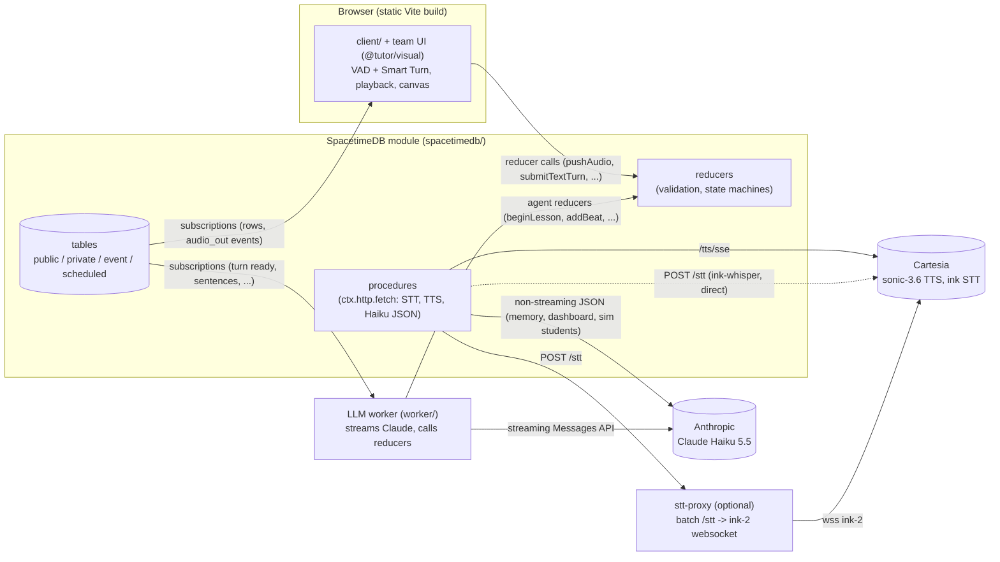
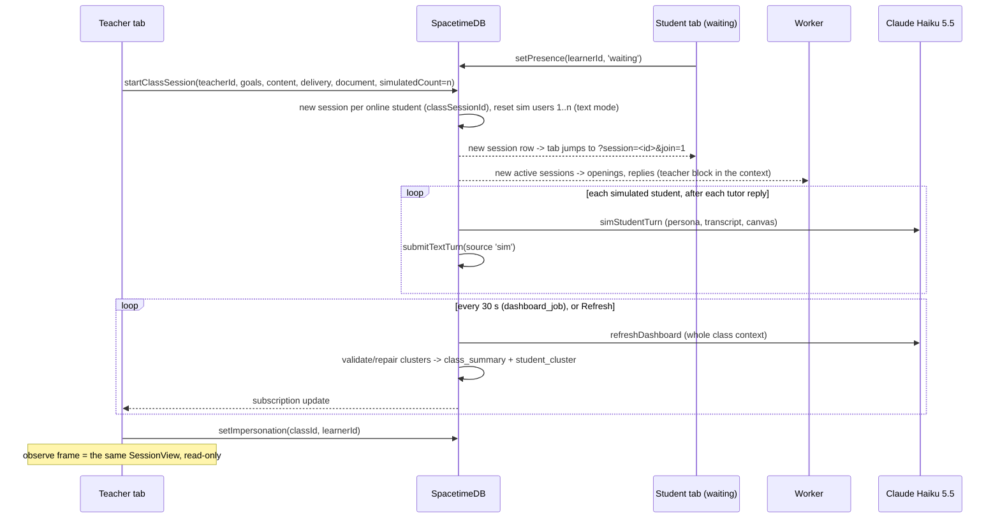

# Architecture

How the voice math tutor works end to end. Audience: CalHacks judges (SpacetimeDB track) and new
teammates. Services and libraries are in [SERVICES.md](SERVICES.md); the demo script is in
[DEMO.md](DEMO.md). Deeper references: [CLASSROOM.md](CLASSROOM.md) (classroom), [CONTRACT-night.md](CONTRACT-night.md)
(table/reducer contract of the lesson pipeline), [latency-internal.md](latency-internal.md)
(measured latency), [client/README.md](../client/README.md) (screens, VAD, playback, test ids).

## 1. The rule: SpacetimeDB is the only data path



Four processes, one data path:

| Component | Where | What it does | What it does NOT do |
| --- | --- | --- | --- |
| **Browser client** | `client/` (+ team UI in `src/` via the alias `@tutor/visual`, pure teaching code in `teaching/` as `@tutor/teaching`) | Mic capture, VAD (Silero) and semantic turn end (Smart Turn) in the browser, pushes PCM chunks, plays `audio_out`, renders the canvas (`beat` rows) keyframed to speech, entry flow, teacher dashboard. Builds to static files (`pnpm build` → `client/dist/`) | No server endpoints, no LLM calls, no API keys |
| **SpacetimeDB module** | `spacetimedb/` (TypeScript module) | All state, every validation (turns, phases, lesson beats, clusters), STT/TTS calls, memory extraction, classroom simulation, dashboard summaries; scheduling | Can't consume a token stream (see below) |
| **LLM worker** | `worker/` (Node) | Streams Claude Haiku 5.5 and turns the stream into reducer calls (`beginLesson`, `addBeat`, ...); connects as a normal SpacetimeDB client registered as `agent` | Decides nothing about lesson flow: every accept/reject comes from the module |
| **STT proxy** (optional) | `stt-proxy/server.ts` (Node), `stt-proxy/stt-proxy.php` (PHP host) | Exposes Cartesia's batch `POST /stt` interface on top of the `ink-2` websocket | Holds no state, stores no key (uses the caller's `Authorization` header) |

Client and worker never talk to each other. Everything a screen shows is a subscription; everything a
user or the LLM does is a reducer call that the module validates.

**Why a worker exists.** A procedure's `ctx.http.fetch` is synchronous and returns the complete
response, so it can't consume a token-by-token LLM stream (async procedures: SpacetimeDB issue #4697).
Streaming is the one thing that decides time-to-first-audio, so it lives in the worker; non-streaming
LLM work (memory, session summaries, dashboard, simulated students) stays in module procedures.

**Why an STT proxy.** Cartesia's newest STT model `ink-2` is websocket-only; procedures can't open
websockets. The proxy keeps STT a module procedure (`transcribePhrase` POSTs one phrase in one batch
request, exactly as it would to a batch `ink-2` endpoint) and translates to the websocket. SpacetimeDB
2.13 also refuses procedure HTTP to loopback/private addresses, so the proxy must run on a public
HTTPS host (`stt-proxy.php`). Until one is deployed, `STT_BASE_URL=https://api.cartesia.ai` +
`CARTESIA_STT_MODEL=ink-whisper` calls Cartesia's own batch endpoint directly; all measurements in
these docs used that setup. Details: README "STT decision".

## 2. Tables

All tables are defined in `spacetimedb/src/schema.ts` (voice, board, memory, library),
`schema_pipeline.ts` (text mode + lesson planner) and `schema_classroom.ts` (classroom).
**Public** = clients may subscribe; **private** = only module code (and the agent-only procedures that
read them) can see them; **event** = rows are broadcast to subscribers at commit and never stored;
**scheduled** = each row is a timer that runs a reducer/procedure at `scheduledAt`.

### Learners and sessions

| Table | Kind | Purpose |
| --- | --- | --- |
| `learner` | public | Students (name, age, grade, learning style). `isSimulated` / `simRank` mark the 20 simulation users |
| `session` | public | One tutoring session: `turnState` (listening / thinking / speaking / interrupted), `phase`, topic (`category`, `concept`), `currentUtteranceId`, `voice` (false = text mode), `classSessionId` (0 = ad-hoc), `pendingPhoto` (a turn photo waits for the next turn; no bytes) |
| `session_image` | private | Task photo (≤ 1 MB, compressed in the browser); read by the worker via `getSessionImage` |
| `turn_image` | private | Photos taken during the session ("take a picture at any time", ≤ 1 MB JPEG): `bound` false = pending (at most one per session), then `turnIdx` / `usedAt` of the student turn it went out with; read by the worker via `getTurnImage` |
| `session_owner` | private | Identity that started an ad-hoc session (`startSession`); only it may attach turn photos |
| `role` | private | Identity → `agent`; written by `registerAgent` with the shared `AGENT_SECRET` |

### Voice input

| Table | Kind | Purpose |
| --- | --- | --- |
| `audio_in` | private | Buffered 16 kHz PCM16 chunks of a phrase, joined by `seq` and deleted after transcription |
| `speech_activity` | **event** | "The student is speaking" pings (no audio) so the worker can abort a preemptive reply |
| `phrase` | public | One phrase between short pauses: status streaming → transcribing → done / discarded, transcript text |
| `turn` | public | Conversation turns (student and tutor): status open → closing → ready → done, `pendingPhrases`, `source` (voice / text / sim), `intent` (lesson buttons), `interrupted`, `hasPhoto` (a turn photo was sent with this student turn) |

### Voice output

| Table | Kind | Purpose |
| --- | --- | --- |
| `reply_sentence` | public | One tutor sentence: `display` (with math) / `speech` (spoken form), status pending → ready → played / dropped |
| `audio_out` | **event** | Synthesized PCM (24 kHz) of one sentence + word timestamps; streamed to the session's subscribers, never stored |
| `playback_flush` | **event** | "Stop playing utterance X" for every client of a session (barge-in, typed interrupt) |
| `turn_metrics` | public | Per reply: turn end, STT done, LLM first token, first sentence, first audio, first playback (the debug panel's latency table) |

### Board and content library

| Table | Kind | Purpose |
| --- | --- | --- |
| `board_item` | public | Board items of the tool reply mode (`REPLY_MODE=tools`), anchored to a sentence / marker word |
| `board_answer` | private | Expected answers of gap tasks: the answer key never reaches the client |
| `category`, `concept`, `skill`, `explanation`, `task` | public, read-only | Content library loaded from the lesson pack on `init` / connect (`spacetimedb/src/library.ts`) |
| `library_meta` | private | Pack version (reload on republish) |

### Lesson pipeline (team methodology)

| Table | Kind | Purpose |
| --- | --- | --- |
| `canvas_state` | public | The canvas the learner sees (team `CanvasState` JSON) + version. Advances with each accepted beat or learner manipulation; rolled back to the last seen beat on interrupt |
| `beat` | public | One compiled and validated lesson moment (team `VisualBeat`: cues with `atMs` + commands), `sentenceIdx` = the sentence that reveals it |
| `lesson_state` | public | Public view of the team `TeachingSession`: stage (needs_plan / presenting / awaiting_response / completed), open check prompt, evidence, notes (no answer key) |
| `learner_event` | public | Canvas manipulations, picture submissions, choices: accepted or not, with evidence |
| `lesson_record` | private | Authoritative `TeachingPlanner` record (current step incl. its check with the answer, history) |
| `lesson_plan` | private | The lesson being streamed for one utterance (meta, accepted beats, canvas after each beat) |
| `agent_status` | public | Worker heartbeat (row 0, every 5 s): model, provider, busy sessions. The UI shows "tutor online" |
| `tutor_request` / `tutor_result` | public | Request/result rows for the slant lesson's tutor feedback (replaces the old `/api/teaching/shear-feedback`) |
| `text_playback` | private | Reading clock of a text-mode session |

### Memory (all private)

| Table | Purpose |
| --- | --- |
| `memory_note` | Notes about the learner (misconception, strength, preference, ...), with confidence and `reinforced` count |
| `note_evidence` | Quote + turn range that supports a note |
| `concept_state` | Mastery 0–100 per learner and concept |
| `session_summary` | Summary + next focus written at session end |
| `extraction_cursor` | First turn not yet processed + a running marker (no duplicate windows) |

Memory is never subscribed to by a client; it reaches the LLM only through the agent-only procedures
`buildContext` / `buildLessonRequest`, and the dashboard through its own procedure.

### Classroom

| Table | Kind | Purpose |
| --- | --- | --- |
| `teacher` | public | Teachers (no accounts) |
| `presence` | public | Student online state: offline / waiting / in_session, with the connection that set it |
| `class_session` | public | A class: goals, content, delivery instructions, optional document (Markdown text inline), `simulation`, `simulatedCount`, `active` |
| `class_document` | private | Image payload of the class document (reaches the worker like a task photo) |
| `sim_profile` | public, read-only | 20 seed students (persona, misconceptions, seed memory) from `shared/src/classroom/simStudents.ts` |
| `class_summary` | public | Class-wide LLM summary + version |
| `student_cluster` | public | Groups of exactly 2 or 4 students (one 3 only for odd classes) with a short name and description |
| `dashboard_state` | public | Who the teacher is observing, `nextDueAt`, `running`, `lastError` |
| `sim_running` | private | Student-LLM calls in flight (concurrency cap) |

### Scheduled tables

| Table | Runs | When | Notes |
| --- | --- | --- | --- |
| `stt_job` | procedure `transcribePhrase` | now, on a phrase's final chunk | one retry after 0.3 s, then the phrase is discarded |
| `tts_job` | procedure `synthesizeSentence` | now, per sentence (voice mode) | a failed call schedules one retry row (`attempt` 1, after 0.2 s, only while the sentence is pending), then the sentence is `dropped` so playback skips it; barge-in deletes pending rows |
| `text_play_job` | reducer `finishTextSentence` | after the reading time of a text-mode sentence: `max(700 ms, 280 ms × words)`, sentences one after another | scheduler-only (checks `ctx.sender == ctx.identity`) |
| `extraction_job` | procedure `extractMemory` | every `MEMORY_EVERY_N_TURNS` (6) turns, and once at session end | retries after 10 / 30 / 90 s; a run that takes the window also queues a backup row due after the 300 s stale limit (deleted when the run ends), so a crashed run cannot lose the window |
| `summary_job` | procedure `summarizeSession` | at session end | one per session (not scheduled while one is queued); retries after 10 / 30 / 90 s |
| `sim_turn_job` | procedure `simStudentTurn` | 2–5 s after the tutor finished speaking to a simulated student | busy re-check every 1.5 s (max 40), failures retried after 5 s twice; stale jobs do nothing |
| `dashboard_job` | procedure `dashboardTick` | `DASHBOARD_INTERVAL_S` (30 s) after the previous refresh finished | failed run retried in 10 s; skipped while the teacher observes |
| `retention_job` | reducer `runRetention` | one interval row, every 5 min (created on init and on connect) | scheduler-only; idempotent sweep, see Retention |

### Retention

`retention.ts` deletes what is only needed while a session runs:

| Data | Deleted | Env |
| --- | --- | --- |
| `turn_image`, `session_image` (photo bytes) | `RETENTION_IMAGE_MIN` minutes (default 30) after the session ended | `0` / `off` keeps them |
| `class_document` (image bytes of a class's document) | the same time after the class session ended | same |
| `lesson_record`, `lesson_plan`, `beat` (planner JSON) | `RETENTION_DAYS` days after the session ended | default off |
| `audio_in` (raw mic audio) | at transcription and at session end (not the sweep) | |

Kept: sessions, turns, phrases (text), reply sentences, metrics, `lesson_state`, `canvas_state`,
memory notes, evidence, mastery, summaries, and the history flags `session.hasImage` /
`turn.hasPhoto`. A sweep only touches rows past their limit, so it is idempotent; photo tables stay
small, so it reads them whole (`lesson_record` / `lesson_plan` only when `RETENTION_DAYS` is set).

### Indexes

Every column module code looks rows up by has a btree index; no reducer or procedure scans a whole
table that grows with use (only the small fixed ones: the content library on a pack reload and
`sim_running`, which holds at most `SIM_MAX_CONCURRENT` rows). Besides primary keys:

| Table | Indexed columns |
| --- | --- |
| `session` | `learnerId`, `active`, `classSessionId` (linked sessions of a class, dashboard subscription) |
| `learner` | `isSimulated`, `simRank` (simulation users by seed rank; real learners have rank 0) |
| `presence` | `connectionId` (disconnect), `status` (who joins a starting class) |
| `turn`, `phrase`, `audio_in`, `turn_metrics` | `sessionId` + `(sessionId, idx / phraseId / turnIdx)` |
| `reply_sentence`, `turn_metrics` | `utteranceId` (sentences / metrics of one utterance) |
| `reply_sentence` | `sessionId`, `(utteranceId, idx)` |
| `stt_job`, `tts_job`, `text_play_job`, `extraction_job`, `summary_job`, `sim_turn_job` | `sessionId` (cancel or find a session's jobs); `tts_job` also `utteranceId` |
| `board_item`, `beat`, `learner_event`, `lesson_plan`, `turn_image`, `tutor_request`, `tutor_result` | `sessionId` |
| memory tables | `learnerId` (`memory_note`, `concept_state`, `session_summary`, `seed_session`), `noteId` (`note_evidence`), `(learnerId, concept)` |
| classroom | `class_session.teacherId` / `active`, `student_cluster.classSessionId`, `dashboard_job.classSessionId` |

Lookups by the first column of a multi-column index use the single-column index instead: a prefix
scan whose last element is a point (`byUtteranceIdx.filter(utteranceId)`) is valid on the host, but
the 2.13 test datastore (`spacetimedb/server/test-utils`) cannot decode its empty range end ("Could
not decode arguments to index scan"). Adding an index is an additive migration: `spacetime publish`
without `--clear` creates it on a database with data.

## 3. Reducers and procedures

Signatures live in `spacetimedb/src/index.ts`; bodies in the file named per row. "Client" means any
connected client: by spec there is no authentication (test users only), so client reducers validate
their arguments and the session state, not the caller. "Agent" reducers call `requireAgent`, which
checks the caller's identity in the private `role` table.

| Reducer / procedure | Caller | File | What |
| --- | --- | --- | --- |
| `init`, `onConnect` | lifecycle | `library.ts`, `classroom.ts` | Load the content library and the 20 sim profiles (cheap when unchanged) |
| `onDisconnect` | lifecycle | `classroom.ts` | That connection's real learners → `offline` |
| `createTestUser` | client | `sessions.ts` | New learner |
| `startSession(learnerId, taskText)` | client | `sessions.ts` | Ends the learner's active session, starts a new one |
| `uploadPhoto` | client | `sessions.ts` | Task photo (jpeg/png/webp/gif, ≤ 1 MB) |
| `attachImage(sessionId, mime, data)` | client (session owner) | `turn_photo.ts` | Photo taken during the session (jpeg/png/webp/gif, ≤ 1 MB); replaces a still-pending one, sets `session.pendingPhoto`. Completing the learner's next student turn (`completeTurn`) binds it to that turn (`turn.hasPhoto`). Owner = the identity that started the session, or for class sessions the connection holding the learner's `presence` |
| `removePendingImage(sessionId)` | client (session owner) | `turn_photo.ts` | Drops the pending photo |
| `endSession` | client | `sessions.ts` | Closes turns, drops unplayed sentences and deletes their pending `tts_job`s, schedules final memory extraction + summary |
| `startConversation` | client (module for sims) | `opening.ts` | Session screen opens (voice auto-starts): tutor speaks first (turnState thinking) |
| `pushAudio(sessionId, phraseId, seq, pcm, final)` | client | `voice_in.ts` | Buffers a 160 ms chunk; `final` closes the phrase and inserts an `stt_job` due now; emits `speech_activity` |
| `endTurn` | client | `voice_in.ts` | Turn end from VAD/Smart Turn; the turn is `ready` once every phrase is transcribed |
| `interrupt` | client | `voice_out.ts` | Barge-in: unplayed sentences dropped and their pending `tts_job`s deleted, `playback_flush`, turnState interrupted |
| `interruptUtterance(sessionId, utteranceId)` | client | `voice_out.ts` | Barge-in scoped to the utterance the client was playing: the current one → `interrupt`; one that just finished (learner cut into its last sentence) → its tutor turn marked interrupted + flush; older ones ignored |
| `markPlayed` | client | `voice_out.ts` | A sentence started playing (drives reveals, first-playback metric, "what was heard") |
| `reportNoise` | client | `index.ts` | Noise floor of the turn, for metrics |
| `submitGapAnswer` | client | `lesson.ts` | Gap task answer, checked against the private `board_answer` |
| `submitTextTurn(sessionId, text, intent)` | client (module for sims) | `text_mode.ts` | Typed turn or a lesson button (`another_way`, `smaller_step`, `continue`, `demonstrate`); interrupts a running reply like barge-in |
| `setSessionVoice(sessionId, voice)` | client | `text_mode.ts` | Text mode on/off |
| `submitInteraction(sessionId, kind, payload)` | client | `pipeline.ts` | Canvas manipulation (`math_action`, `activity_action`), `submit`, `choice`; validated against `canvas_state` and the open check |
| `requestTutor` | client | `pipeline.ts` | Slant-lesson feedback request row (`tutor_request`). No UI calls it today; the worker (`tutorRequests.ts`) serves the rows if one appears |
| `registerAgent(secret)` | worker | `index.ts` | Registers the worker identity as `agent` |
| `agentHeartbeat`, `submitTutorResult` | agent | `pipeline.ts` | Heartbeat row 0; result of a `tutor_request` |
| `beginUtterance`, `beginOpening` | agent | `voice_out.ts`, `opening.ts` | Start a tutor reply (or the opening) with a worker-chosen unique utterance id |
| `beginLesson(sessionId, utteranceId, meta)` | agent | `pipeline.ts` | Lesson meta, validated with the team schema + phase policy + "no repeated check" before anything is spoken |
| `addBeat(sessionId, utteranceId, idx, visual, narration)` | agent | `pipeline.ts` | One moment: compiled against `canvas_state`, `beat` + `reply_sentence`s (+ `tts_job`s) or `SenderError` with the validator message |
| `addSentence` | agent | `voice_out.ts` | A free sentence (opening script, tool mode) + `tts_job` |
| `appendTutorTurn` | agent | `voice_out.ts` | Final text of a tutor utterance (what was heard, if interrupted) |
| `setTurnState`, `setPhase`, `showBoardItem`, `clearBoard`, `remember`, `recordMetric` | agent | `voice_out.ts`, `lesson.ts`, `memory.ts` | Tool-mode actions and metrics, each validated against the lesson pack |
| `seedMemory(learnerId, memory)` | agent | `seed.ts` | Seeds a learner's history (notes, mastery, past summaries; JSON validated against the pack taxonomy); replaces earlier seeded rows, keeps live notes |
| `buildContext(sessionId) → string` | agent (procedure) | `lesson.ts` | Prompt context: learner + memory, phase, board, task, topic material, teacher block for class sessions |
| `buildLessonRequest(sessionId, requestId) → string` | agent (procedure) | `pipeline.ts` | The team `ModelRequest` for the current lesson state |
| `prefetchTopic(sessionId) → string` | agent (procedure) | `pipeline.ts` | Topic prefetch before the first lesson reply from the pack's keyword cues (JSON `{ok, category, concept, source, text, hasImage}`); no concept → the worker classifies with the LLM |
| `setTopic(...) → string` | agent (procedure) | `lesson.ts` | Validates + stores the topic, returns the library material |
| `getSessionImage(sessionId) → string` | agent (procedure) | `index.ts` | Task photo (or the class's image document) as a data URL |
| `getTurnImage(sessionId, turnIdx) → string` | agent (procedure) | `turn_photo.ts` | Photo sent with that turn (or the pending one while that turn is still open, for a preemptive reply) as a data URL. The lesson planner puts it into that turn's user message as an image block with "The learner sent a photo with this turn: look at it." (never the system prompt: the cache prefix stays stable) |
| `transcribePhrase` | scheduled (`stt_job`) | `voice_in.ts` | Joins the phrase's chunks, `POST {STT_BASE_URL}/stt`, writes the text, lowers `pendingPhrases` |
| `synthesizeSentence` | scheduled (`tts_job`) | `voice_out.ts` | Cartesia `/tts/sse` → `audio_out` event + sentence `ready` |
| `finishTextSentence` | scheduled (`text_play_job`) | `text_mode.ts` | Text mode: sentence counts as played |
| `extractMemory`, `summarizeSession` | scheduled | `memory.ts` | Haiku 5.5 structured JSON → memory tables |
| `createTeacher` | client | `classroom.ts` | |
| `setPresence(learnerId, status)` | client | `classroom.ts` | offline / waiting / in_session; `waiting` during an active class joins it at once (late joiner) |
| `startClassSession(teacherId, goals, content, delivery, documentName, documentMime, documentText, documentData, simulatedCount)` | client | `classroom.ts` | Ends the teacher's previous class, links every online student into a new session, starts the simulation |
| `startClassSessionWith(..., resetSimulated)` | client | `classroom.ts` | `startClassSession` with the sim reset as an option: `false` keeps simulation users' memory and history from earlier runs |
| `resetSimulatedStudents(count)` | client | `classroom.ts` | Simulation users 1..count (0 = all 20) back to their seed state; refused while one is in a running class |
| `endClassSession` | client | `classroom.ts` | Ends linked sessions; real students back to `waiting` |
| `setImpersonation(classSessionId, learnerId)` | client | `classroom.ts` | Teacher observes a student (0 = stop; an overdue refresh then runs at once) |
| `refreshDashboard(classSessionId) → RefreshDashboardResult` | client (procedure) | `classroom.ts` | Refresh button: one Haiku call → summary + clusters. Typed product `{ok, skipped, error, repaired, repairs, clusters}` ('' / false / 0 = not set) |
| `learnerInsights(learnerId, teacherId, key) → string` | client (procedure) | `insights.ts` | Teacher's student profile: memory notes, mastery, last 5 summaries (JSON `LearnerInsightsResult`, `shared/src/insights.ts`) |
| `dashboardTick`, `simStudentTurn` | scheduled | `classroom.ts` | 30 s dashboard cadence; next simulated student message |

**Error convention.** A reducer or procedure that refuses its input throws `SenderError` (unknown
ids, ended session, wrong caller, validation of client and agent arguments, LLM output a reducer
rejects, e.g. `addBeat` / `beginLesson`; the worker's repair round reads the message). A result
`{ok: false, ...}` is used only where the caller needs a structured outcome rather than a failure:
the agent procedures the LLM tool loop feeds back to the model (`setTopic`, `buildLessonRequest`,
`prefetchTopic`: `{ok:false, error}` becomes the tool result), `learnerInsights` (error codes the
profile panel maps to text) and `refreshDashboard` (a skip or a provider failure is a note on the
button). Scheduled reducers / procedures log and retry; they throw only for "scheduler only".

**Return types.** `refreshDashboard` returns a typed product (`t.object`); the client accepts the
older JSON string too, so a client deployed before a module update keeps working. The other
procedures still return JSON strings on purpose: `learnerInsights` has a nested contract
(`shared/src/insights.ts`, ids as decimal strings, times as Unix ms) that the client validates with
`parseInsights` and also loads from fixtures; mirroring it as SpacetimeDB product types would put a
second definition next to the shared one, and a module republish would break every deployed client
until it is rebuilt. The agent procedures' JSON goes straight into LLM prompts. Changing a
procedure's return type is accepted by `spacetime publish` without `--clear` (verified locally), but
it is a breaking change for clients built from older bindings.

## 4. Voice turn, end to end

```mermaid
sequenceDiagram
    autonumber
    participant B as Browser
    participant S as SpacetimeDB
    participant STT as STT (proxy / Cartesia)
    participant W as Worker
    participant LLM as Claude Haiku 5.5
    participant TTS as Cartesia sonic-3.6

    Note over B: Silero VAD (32 ms frames) finds speech, pre-roll attached
    loop every 160 ms while speaking
        B->>S: pushAudio(sessionId, phraseId, seq, pcm, final=false)
        S-->>W: speech_activity (event)
    end
    B->>S: pushAudio(..., final=true) after 300 ms silence (phrase end)
    S->>S: stt_job due now
    S->>STT: transcribePhrase: POST /stt (whole phrase)
    STT-->>S: text -> phrase.done, turn.pendingPhrases - 1
    Note over B: Smart Turn v3.2 says "complete" (>= 750 ms silence) or 900 ms silence
    B->>S: endTurn(sessionId)
    S-->>W: subscription: turn status = ready
    W->>S: buildLessonRequest (procedure)
    W->>LLM: stream {"meta":..., "moments":[...]}
    W->>S: beginUtterance + beginLesson(meta)
    loop each moment, released when the next "," proves it complete
        LLM-->>W: tokens
        W->>S: addBeat(idx, visual, narration)
        S->>S: compile + validate vs canvas_state -> beat, reply_sentence(s), tts_job(s), canvas_state++
        S-->>B: beat + reply_sentence rows
        S->>TTS: synthesizeSentence: POST /tts/sse
        TTS-->>S: PCM + word timestamps
        S-->>B: audio_out (event)
    end
    B->>B: play strictly by idx; beat shows when its first sentence starts
    B->>S: markPlayed(utteranceId, idx)
    W->>S: appendTutorTurn
    S->>S: all sentences played -> turnState listening, lesson_state awaiting_response
```

Details that matter:

- **Phrases are transcribed while the student is still talking.** Only the last phrase's STT falls into
  the turn-end wait. A turn is `closing` after `endTurn` and becomes `ready` when `pendingPhrases`
  reaches 0 (`voice_in.ts`).
- **Turn end in the browser.** `audio/vadMachine.ts` is a pure state machine over Silero
  probabilities and a noise floor (SNR gate, `noisy` raises the threshold). At each phrase end
  `audio/SmartTurn.ts` runs Pipecat Smart Turn v3.2 in a Web Worker on the last ≤ 8 s of the turn;
  P(complete) ≥ 0.5 ends the turn once 750 ms of silence passed, otherwise `VAD_TURN_MS` (900 ms) is
  the fallback. Measured: turn end at ~608 ms of silence instead of ~928 ms when Smart Turn is sure
  ([latency-internal.md](latency-internal.md)).
- **Preemptive LLM start.** The worker may start the LLM before the turn is `ready` (after
  `PREEMPTIVE_SILENCE_MS` of silence once every phrase is transcribed), holding all output behind a
  gate; a new `speech_activity` or changed transcript discards it.
- **Barge-in.** Speech above `BARGE_IN_THRESHOLD` for `BARGE_IN_MIN_MS` while the tutor speaks: the
  client stops playback in the same tick and calls `interrupt`; the module drops unplayed sentences,
  emits `playback_flush` (so observers stop too), records what was actually heard, and rolls the
  canvas back to the last beat the learner saw.
- **Playback.** `audio/PlaybackQueue.ts` plays `audio_out` strictly by sentence `idx` (a missing index
  is skipped after 6 s or when its sentence is `dropped`), trims silence, fades, and calls
  `markPlayed` at each sentence start. The avatar's mouth follows the playback RMS.
- **Keyframe reveal.** A `beat` row appears on the canvas when the sentence `beat.sentenceIdx`
  starts playing; inside a beat the team `VisualDirector` plays its cues at their `atMs` offsets.
  Board items of the tool mode can also be anchored to a word (`markerPos` + TTS word timestamps).
  Observers have no audio and reveal on `reply_sentence.status = played`.
- **The opening** (tutor speaks first) is an authored script from the lesson pack spoken via
  `addSentence`, no LLM call: ~0.5 s from click to audio. Lessons start with the first student turn.

Measured (real Haiku 5.5 + Cartesia, local server): turn end → first audio p50 **2.5 s** with the
lesson planner (4.3 s with the older tool loop); the system's own overhead on that path is ~100 ms
(p50 101 ms; the rest is policy silence windows and external HTTP), see
[latency-internal.md](latency-internal.md).

## 5. Text mode

`session.voice = false` (start form "Type instead of talking", `?voice=0`, all simulated students).
Same pipeline, minus speech:

```mermaid
sequenceDiagram
    participant B as Browser
    participant S as SpacetimeDB
    participant W as Worker
    B->>S: submitTextTurn(sessionId, text, intent)
    Note over S: complete student turn (status ready) in one transaction;<br/>a running reply is interrupted like barge-in
    S-->>W: turn ready
    W->>S: beginLesson / addBeat (same as voice)
    S->>S: no tts_job: sentence ready at once,<br/>text_play_job after max(700, 280 ms x words)
    S-->>B: beat + reply_sentence rows
    S->>S: finishTextSentence -> played -> listening
```

The reading delay keeps `turnState` flowing thinking → speaking → listening, so the avatar,
the dashboard and the simulation see the same states as in voice mode. The client plays beats with
local Pause / Next / Skip / Replay controls.

## 6. Lesson pipeline (team methodology in SpacetimeDB)

The team's teaching methodology (contracts, compact canvas compiler, validators, streaming parser,
`lessonFlow` state machine) is pure TypeScript in `teaching/` (`@tutor/teaching`) and runs in all
three places: the **worker** uses the streaming parser to release moments early, the **module** uses
the compiler and validators authoritatively, the **client** uses the canvas (`VisualDirector`).

1. **Request.** `buildLessonRequest` (agent procedure) builds the team `ModelRequest` from the private
   `lesson_record`, the current `canvas_state`, the learner profile and memory.
2. **Stream.** The worker streams Claude Haiku 5.5 (team prompt, thinking off, `LESSON_EFFORT=low`)
   into `{"meta": {...}, "moments": [...]}`. `LessonStreamParser` releases the meta first and each
   moment as soon as the next `,` proves it complete.
3. **Validate the plan before speaking.** `beginLesson` checks the meta with the team schema, the
   phase policy (`allowedPhases` / `phaseOptionsAfterAssessment` from the learner's evidence) and
   rejects a check question the learner was already asked.
4. **Compile each moment against the live canvas.** `addBeat` compiles the compact command against
   `canvas_state` (at most 8 moments; the canvas version must match the plan), splits the narration
   into sentences (`reply_sentence`, `tts_job` in voice mode), inserts the `beat` and advances
   `canvas_state`. The final moment (`final: true`) validates the whole step (`validateModelStep`)
   and appends the check prompt; the step and its answer key go into the private `lesson_record`,
   the public `lesson_state` gets the check without the answer.
5. **Repair / recap.** A rejection is a `SenderError` with the validator's message. Before anything
   was spoken the worker runs one repair round (the message goes back to the model); after that it
   truncates and closes with a recap beat that carries the check ("Look at the whole picture once
   more."). Deadlines: first token 9 s (retried once), 45 s total, 15 s stall after the first beat;
   a ready turn with no reply after 12 s is answered again once.
6. **Presented or interrupted.** When every sentence played, the lesson is presented
   (`awaiting_response`). An interrupt rolls `canvas_state` back to the scene after the last beat the
   learner saw.
7. **Learner response.** Spoken or typed answers while `awaiting_response` are assessed with the team
   `assessResponse`; buttons map to help evidence (`another_way`, `simpler`, `explain`); canvas
   manipulations and picture submissions arrive through `submitInteraction` and are validated
   against `canvas_state`. The evidence drives the next request's allowed phases.

`REPLY_MODE=tools` keeps the earlier tool loop (`show_board_item(math_canvas)`, `ask_learner`,
`set_phase`, ...) as a switchable fallback.

## 7. Two-minute lesson arc

Can's rigid structure for a demonstrable lesson (data: `shared/src/lesson/pack/arcs.ts` → `pack.arcs`; interpreter: `teaching/src/teaching/arc.ts`, carried in `SessionConfig.arc` so the phase policy and `validateTeachingStep` follow it).

| Stage | Content | Enforced by |
|---|---|---|
| Lead-in | authored, ~5–7 s, first audio ~0.5 s after the click; the tutor leads (no opening diagnosis) | worker `LESSON_OPENING=lesson` |
| Explanation | 4–5 moments, ≤ 115 words, picture first; moment 3 = formalization (equation forced and revealed on the sentence that reads it) | module moment cap, `splitKeyframes` (module) + `keyframeParts` (client) |
| Task | one choice/number task with different numbers than the homework (a check containing the original question is rejected before anything is spoken) | module + worker early reject |
| After the task | correct → hand back; unclear / wrong / "I don't know" / interrupted → one repair (3–4 moments, smaller task) → hand back without check | arc policy |

Switches: module env `LESSON_ARC=demo2min` (default) | `adaptive` (previous policy); worker `LESSON_OPENING=lesson|script`, `LESSON_LIBRARY=1|0`.

Measured (seconds of audio after the start click): explanation 8–11 s, formalization 21–32 s, task 33–49 s (E2E voice, 8 scenarios); worst case ("I don't know" twice) whole arc ~90 s in voice, ~84 s in text mode. Topic prefetch (pack keyword cues 50–110 ms; Haiku fallback with the photo) and the library index in the cached system prompt add no measurable latency (first beat 1.8–2.0 s with library vs 2.1–2.5 s without). Barge-in during the last sentence uses `interruptUtterance(sessionId, utteranceId)`.

Known limits: word budgets are prompted (the model often exceeds them: explain 107–150 words); the homework guard is a substring check (paraphrases pass).

## 8. Memory

- Every `MEMORY_EVERY_N_TURNS` (6) turns `onTurnAppended` schedules an `extraction_job` for the new
  window; `endSession` schedules the last window and a `summary_job`.
- `extractMemory` sends the window plus the learner's existing notes to Claude Haiku 5.5 (raw HTTP,
  structured outputs, effort medium) and writes notes, evidence quotes and concept mastery. Items
  below confidence 0.7 are dropped; duplicate creates become `reinforce`.
- The cursor's running marker prevents a window from being sent twice while its LLM call runs.
- Next session, `buildContext` / `buildLessonRequest` put the notes into the prompt; simulated
  students start with 3–6 seed notes each.
- Background only: none of this is on the turn's critical path. Measured: extraction 2.1–4.6 s,
  summary 3.2 s.
- **Read path for teachers.** The memory tables stay private (no subscription path). The only
  client read path is the procedure `learnerInsights(learnerId, teacherId, key)` (`insights.ts`),
  opened from the teacher dashboard's student profile. One `withTx` read, returns
  `JSON.stringify(LearnerInsightsResult)` (`shared/src/insights.ts`): learner (+ sim persona,
  session count, first/last seen), up to 60 notes ordered misconception → strategy → mnemonic →
  quote → understood → preference, then newest first, each with concept title, the last 2
  evidence rows (quotes ≤ 200 chars) and `seeded` (no evidence = simulation seed note, or only
  evidence on the reserved seed pseudo session of `seedMemory`, `seed.ts`; pseudo session ids are
  sent as `''`, also for the seed summary, which has task text / topic `''`); concept
  mastery with concept + category titles; the last 5 session summaries with task text and topic.
  u64 ids are strings, times are Unix ms. Errors: `locked` (module env `INSIGHTS_KEY` is set and
  the key does not match; checked first), `unknown_teacher`, `unknown_learner`.
- **Privacy trade-off.** The gate is an existing teacher id plus the optional `INSIGHTS_KEY`.
  There is no authentication (test users only), so without `INSIGHTS_KEY` anyone who knows a
  teacher id (small autoincrement numbers) can read any learner's profile. Acceptable for the test
  users of this build; the real fix is teacher identities (teacher row bound to `ctx.sender`) and a
  per-sender view or procedure check that only returns learners of that teacher's classes. Set
  `INSIGHTS_KEY` (publish passes `INSIGHTS_*`) for any shared deployment.

## 9. Classroom

Details and measurements: [CLASSROOM.md](CLASSROOM.md).



- **Presence and class sessions.** Students choose "Wait for my teacher" (`presence = waiting`).
  `startClassSession` moves every online student (waiting or in a session) into a new linked session
  carrying the teacher's goals, content and delivery instructions (binding) and the document, ending
  their previous session. Late joiners who go `waiting` during an active class join at once.
  `endClassSession` sends real students back to the waiting room.
- **Simulation.** n (≤ 20) seed students, used in seed order, are reset on each run (all their rows
  deleted and recreated with seed memory) and get text-mode sessions. After each tutor reply a
  `sim_turn_job` (2–5 s) asks Haiku for the next message in the persona's voice with a behaviour mix
  (30 % typical mistake, 15 % question, 10 % hesitant, 45 % honest best). Caps: `SIM_MAX_TURNS` (8)
  per session, at most 4 student-LLM calls in flight. The tutor side is the normal worker reply.
- **Dashboard.** One Haiku call per refresh with every active student's context (profile, phase, lesson
  state, canvas, memory, last 16 turns) returns a class summary and clusters. Code enforces the rule
  "every cluster has exactly 2 or 4 students" (`shared/src/classroom/clusters.ts`, deterministic
  repair) and strips learner ids from prose. Summary, clusters and state are written in one
  transaction. Measured: 3–10 s per refresh at effort low (≈ $0.0015).
- **Observe = impersonation.** The observe frame renders `<SessionView readOnly embedded />` of the
  student: the same component and the same subscriptions as the student's own tab, minus inputs and
  audio. `setImpersonation` pauses the dashboard cadence while observing; when the teacher stops and
  the refresh is overdue it runs at once.
- **Cadence.** Dashboard every 30 s after the previous run finished (~33–38 s in practice), retry
  10 s after a failure, a run is stale after 120 s (a backup job then takes over).

## 10. Procedures and `ctx.http.fetch`

Procedures are the module's only way out: STT, TTS and all non-streaming LLM calls.

- `ctx.http.fetch` is synchronous and returns the whole response. TTS uses `/tts/sse` anyway (to get
  word timestamps) and parses the full SSE body (`providers.ts` `parseTtsSse`).
- A procedure does its HTTP call **outside** a transaction and writes the result with
  `ctx.withTx(...)`. The insert transaction re-checks state (e.g. the sentence is still `pending`),
  so a barge-in during the call never produces stale audio.
- No SDKs and no `FormData`/`atob` in the module runtime: multipart bodies and base64 are hand-built
  (`providers.ts`), the Anthropic client is raw HTTP with structured outputs (`anthropic.ts`).
- **The procedure pool caveat.** The local server runs at most ~10 procedures at once (one per CPU
  core on the test laptop), and a procedure waiting in `ctx.http.fetch` holds its slot for the whole
  call. With 4 parallel voice sessions TTS jobs waited up to 0.7 s for a slot. Mitigations in the
  code: at most 4 simulated-student calls in flight (`sim_running`), one dashboard call per class per
  refresh; known further fix: limit TTS look-ahead per utterance.
- Secrets are module env (`schema(..., { env })`, passed by `scripts/publish.mjs`), never in tables.

## 11. Why this is SpacetimeDB-idiomatic

- **State lives in the database, not in a server.** Sessions, turns, the canvas, the lesson record,
  memory, presence, the dashboard: all tables. There is no backend server; the client is static
  files, and the worker is just another client.
- **Every view is a subscription.** The student tab, the teacher dashboard, the overview and the
  observer subscribe to narrow SQL queries (`... WHERE session_id = X`). The worker is the
  exception: it serves all sessions, so it subscribes to `session WHERE active = true` plus the
  whole `turn` / `phrase` / `reply_sentence` tables, and ignores rows whose session is not active
  in its cache (a join-filtered subscription is on the after-hackathon list,
  [SPACETIME_AUDIT.md](SPACETIME_AUDIT.md)). That is why
  observing/impersonating a student cost nothing to build: the observe frame subscribes to the same
  rows as the student's tab, and fan-out to a second client adds no measurable latency.
  The worker, which serves every session, uses JOIN subscriptions on the active sessions
  (`SELECT t.* FROM turn t JOIN session s ON t.session_id = s.id WHERE s.active = true`, the same
  for `phrase`, `reply_sentence`, `board_item` and the sessions' `learner` rows; `worker/src/stdb.ts`).
  2.13 maintains them incrementally: a session's rows arrive when it starts and are dropped from the
  worker's cache when it ends. On a database with 36 sessions of history the worker's initial
  subscription went from 1456 rows (~487 KiB) to 42 rows (~14 KiB)
  (`pnpm --filter worker exec tsx src/measure-subscriptions.ts`; `src/gen-history.ts` fills a
  scratch database). The teacher screens subscribe likewise: the dashboard to the learners of its
  class's sessions and its teacher, class setup to online students only, the overview to the
  learners of active sessions, the student picker to real learners.
- **Validation in reducers.** The LLM proposes, the module disposes: phase transitions, beats
  compiled against the live canvas, checks, cluster sizes, presence transitions, interaction payloads
  are all validated in transactions; a rejection is a `SenderError` the worker turns into a repair
  round. The worker holds no authority.
- **Private tables hide what clients must not see:** answer keys (`board_answer`, `lesson_record`),
  memory, raw audio, photos, agent roles. Photos (task photo and turn photos) are never visible to
  other students; observer/teacher views only see the `turn.hasPhoto` / `session.pendingPhoto` flags.
  A photo is sent to Anthropic (Claude Haiku) as part of the planner request of its turn.
- **Event tables for streams.** Audio (`audio_out`), flushes and speech pings are event rows: delivered
  to subscribers at commit, never stored, no cleanup.
- **Scheduled tables instead of external queues.** STT, TTS, reading delays, memory windows, simulated
  students and the 30 s dashboard are rows with `scheduleAt`; cancellation is a delete of the
  pending job row (barge-in, supersede and `endSession` delete the reply's `tts_job`s) plus a status
  check in the job's commit transaction for a call already in flight. Retries are new rows: STT,
  TTS (`tts_job.attempt`, one retry after 0.2 s, only while the sentence is still pending) and
  memory windows schedule the next attempt instead of looping inside the procedure.
- **Procedures for side effects, reducers stay pure and fast.** Reducers make no network calls; every
  outbound call is a procedure that commits its result in its own transaction.
- **One identity model, for the worker.** The worker authenticates as `agent` via a shared secret
  once (`registerAgent`); agent-only reducers check `role`. Client reducers do not check
  `ctx.sender` (test users, no accounts by spec), except the turn-photo owner check.
- **Measured overhead is small.** Reducer round trip ~8 ms, commit → subscriber ~7 ms, ~100 ms of
  total system overhead per voice turn ([latency-internal.md](latency-internal.md)).

## 12. Repository map

| Folder | What |
| --- | --- |
| `spacetimedb/` | Module: schema, reducers, procedures, scheduled jobs (`spacetimedb/test/` unit tests) |
| `worker/` | LLM worker: `lesson.ts` (lesson planner), `reply.ts` (tool loop), `stdb.ts` (connection, subscriptions), `anthropic.ts` / `llm.ts` (providers) |
| `stt-proxy/` | Batch STT → ink-2 websocket (`server.ts` Node, `stt-proxy.php` PHP host) |
| `client/` | The one static frontend: screens, audio, session view, dashboard; generated bindings in `client/src/module_bindings/` |
| `src/` | Team UI library (app shell, lesson UI, canvas, visuals, interactions), compiled into the client via `@tutor/visual` |
| `teaching/` | `@tutor/teaching`: pure teaching methodology shared by module, worker and client |
| `shared/` | `@tutor/shared`: types, config defaults, sentence chunker, speech normalizer, lesson pack, classroom seed data + cluster rules |
| `e2e/` | End-to-end runs: generated child speech → fake microphone in headless Chrome; latency tooling |
| `scripts/` | `dev.mjs` (whole stack), `publish.mjs` (module + env), `spacetime.mjs` (CLI wrapper) |
