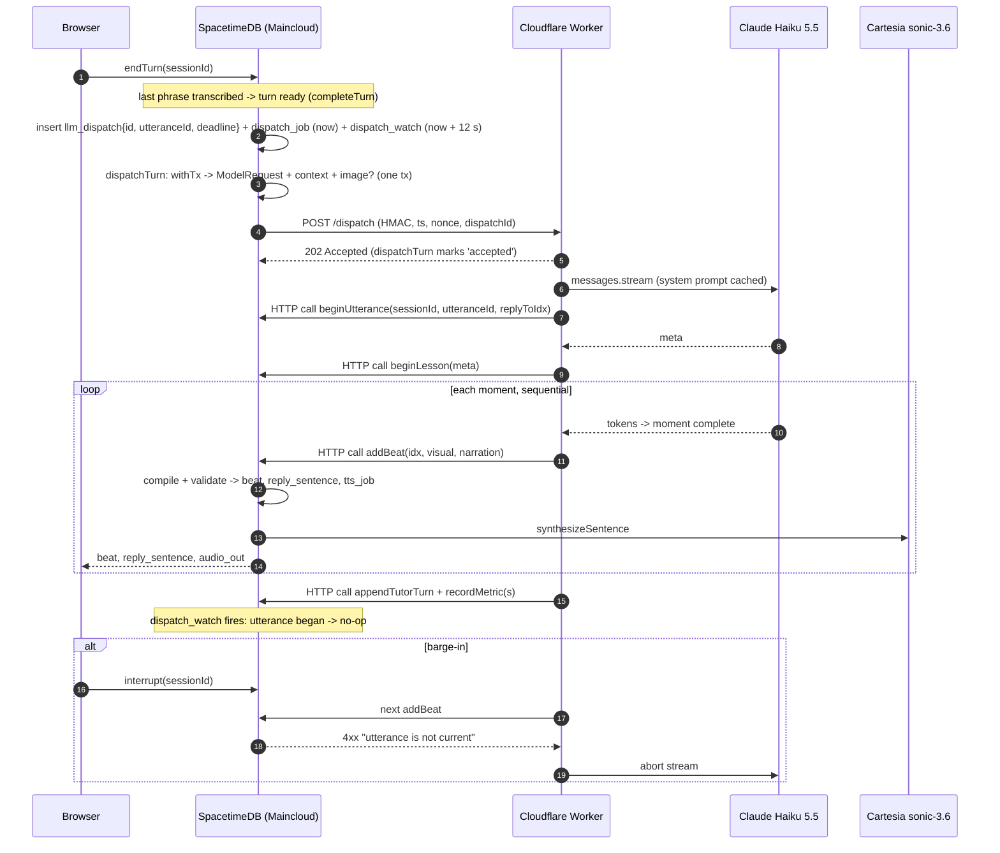

# Cloud plan: Maincloud + a per-turn Cloudflare Worker

**Status: plan only.** Nothing here is implemented, deployed or configured, and no Maincloud or
Cloudflare account was touched while writing it. Written 2026-10-25 against `main` (SpacetimeDB
2.13, worker = `worker/`, module = `spacetimedb/`). The user decides whether and when to start.

Two parts, in order:

- **Part A: move the database to SpacetimeDB Maincloud.** Required first. The Node worker keeps running (on a laptop or anywhere else) and connects to `wss://maincloud…`. This is the same architecture with a hosted database.
- **Part B: replace the long-running Node worker with a Cloudflare Worker that the module calls once per turn.** The worker holds no WebSocket and no subscriptions. It streams Claude and writes back through SpacetimeDB's HTTP API.

End state (outside this plan): once SpacetimeDB procedures can stream HTTP responses, the
Cloudflare Worker can go too ([section 12](#12-end-state-async-procedures-issue-4697)).

Markers used below:

- **Verified (link, date):** checked in the current official docs or source on the date given.
- **Assumption, verify:** not confirmed. A step in the plan settles it before anyone relies on it.

---

## 0. External facts this plan relies on

| # | Fact | Status |
| --- | --- | --- |
| F1 | Publish to Maincloud: `spacetime login` (GitHub/Google), then `spacetime publish <db> --server maincloud`; `--delete-data` clears. Republishing hot-swaps the module without disconnecting clients. Clients connect with host `https://maincloud.spacetimedb.com` plus the database name. Free-tier databases pause when inactive and resume on the next connection or request. | Verified ([deploy/maincloud](https://spacetimedb.com/docs/how-to/deploy/maincloud), 2026-10-25) |
| F2 | HTTP reducer call: `POST /v1/database/:name_or_identity/call/:name`. The body is a **JSON array** of the arguments. Auth is optional `Authorization: Bearer <spacetime token>`. `?confirmed=false` skips the durability wait. **The same endpoint calls procedures** ("The name of the reducer OR procedure"). | Verified ([http/database](https://spacetimedb.com/docs/http/database), 2026-10-25) |
| F3 | `POST /v1/identity` returns `{identity, token}`. `POST /v1/identity/websocket-token` returns a short-lived JWT. The docs do not state how long the `/v1/identity` token lasts. | Verified ([http/identity](https://spacetimedb.com/docs/http/identity), 2026-10-25). **Token expiry: assumption, verify** |
| F4 | Procedures: `ctx.http.fetch` is synchronous. The default timeout is 30 s; a per-call `timeout` is clamped to 180 s. A procedure can't send HTTP while it holds a transaction. Procedures are beta. | Verified ([functions/procedures](https://spacetimedb.com/docs/functions/procedures), 2026-10-25) |
| F5 | SpacetimeDB 2.13 refuses procedure HTTP to loopback and private addresses. | Observed locally (ARCHITECTURE.md §1, README "STT decision"). **On Maincloud: assumption, verify** (public hosts are expected to work) |
| F6 | Module env (`schema(..., { env })`, `ctx.env`, passed by `scripts/publish.mjs` as process env at publish time) works on the local server. **No public doc for this was found.** A feature request still asks for a secrets table. | **Assumption, verify on Maincloud (step A2). Highest-risk unknown of Part A** |
| F7 | Maincloud pricing: Free is $0 with 2,500 TeV/month (about 3M function calls, about 12.5 GB egress). Pro is $25 with 100,000 TeV, and usage beyond the credit is billed at 2,592 TeV per $. Free databases pause after 1 week of inactivity. The pricing page does not meter procedures or outbound HTTP separately; they show up as function calls, CPU and egress. | Verified ([pricing](https://spacetimedb.com/pricing), [blog](https://spacetimedb.com/blog/all-new-spacetimedb-pricing), 2026-10-25). The 90%-off launch sale on [/maincloud](https://spacetimedb.com/maincloud) may have ended: unverified |
| F8 | Maincloud region, data-centre location, procedure concurrency (pool size) and outbound-HTTP rate limits are not published. [/limits](https://spacetimedb.com/limits) lists only storage (24 GB per database on Free) and 8 GB module memory. | **Assumption, measure (step A6)** |
| F9 | Cloudflare Workers limits. CPU time: Free 10 ms per request; Paid 30 s by default, up to 5 min (`limits.cpu_ms`). Wall time: no limit while the client is connected. **`ctx.waitUntil` runs at most 30 s after the response is sent**, and unsettled promises are then cancelled. Subrequests: Free 50, Paid 10,000. **At most 6 simultaneous outgoing connections waiting for headers.** | Verified ([limits](https://developers.cloudflare.com/workers/platform/limits/), [context](https://developers.cloudflare.com/workers/runtime-apis/context/), 2026-10-25) |
| F10 | Durable Objects: alarm handlers can run for up to 15 min of wall time; RPC and HTTP calls have no hard limit while the caller stays connected. Available on Free (SQLite backend). | Verified ([DO limits](https://developers.cloudflare.com/durable-objects/platform/limits/), 2026-10-25) |
| F11 | Workers Paid costs $5/month minimum and includes 10M requests and 30M CPU-ms. Free allows 100k requests per day. | Verified ([pricing](https://developers.cloudflare.com/workers/platform/pricing/), 2026-10-25) |
| F12 | `@anthropic-ai/sdk` lists Cloudflare Workers as a supported runtime. | Verified ([README](https://github.com/anthropics/anthropic-sdk-typescript), 2026-10-25) |
| F13 | [SpacetimeDB #4697](https://github.com/clockworklabs/SpacetimeDB/issues/4697), "V8 procedures: async/await support for blocking host calls", is **open** (opened 2026-03-23, no milestone, no linked PR). It is about yielding at `await` so one V8 worker can serve many in-flight procedures. Streaming is only mentioned as a possible later benefit. | Verified (GitHub, 2026-10-25) |

**Consequences of these facts for the design:**

- **F9 (30 s `waitUntil` cap) is the main constraint.** A lesson's deadline today is 45 s total (`worker/src/lesson.ts` `DEFAULT_DEADLINES`). The plan handles this with a deadline on the Cloudflare side and a Durable Object fallback ([section 7.8](#78-cloudflare-limits-and-what-they-mean-here)).
- **F9 (Free CPU of 10 ms) means Workers Paid is required.** The worker runs `LessonStreamParser` and team validation on every token.
- **F2 (procedures over HTTP)** means the Cloudflare Worker could call `buildLessonRequest` itself. The plan sends the context in the dispatch body instead, to save one round trip.

---

## 1. What the worker does today

All of this has to keep working or be dropped on purpose (sources: `worker/src/{main,stdb,agent,lesson,tutorRequests,topic}.ts`).

| Trigger (subscription) | Worker action | Module calls |
| --- | --- | --- |
| `turn` becomes `ready` (student turn, voice or text or sim) | `LessonRun`: `buildLessonRequest`, stream Haiku, `beginUtterance`, `beginLesson`, `addBeat` ×≤8, `appendTutorTurn`, `recordMetric` | procedures `buildLessonRequest`, `buildContext`, `getSessionImage`; reducers above |
| `session.turnState = thinking`, no utterance (`startConversation`) | Opening: authored lead-in plus the first lesson in the same utterance (`LESSON_OPENING=lesson`) | `beginOpening`, `addSentence`, then as above |
| First reply of a session | Topic prefetch: procedure `prefetchTopic`. When it fails, an LLM classification (with the photo) followed by `setTopic` | procedures `prefetchTopic`, `getSessionImage`, `setTopic` |
| `speech_activity` and `phrase` rows | Preemptive start after `PREEMPTIVE_SILENCE_MS` (200 ms) of silence. Output is held until the turn is `ready` with the same transcript, otherwise discarded | none until release |
| `playback_flush`, or `session.turnState = interrupted` | Abort the LLM stream (barge-in) | none |
| Ready turn with no utterance after 12 s | Stall watchdog: answer again, once per turn | as above |
| `tutor_request` pending | Slant-lesson feedback (non-streaming Anthropic, at most 4 at a time, 30 s), then `submitTutorResult` | `submitTutorResult` |
| Timer every 5 s | `agentHeartbeat`, so the UI shows "tutor online" | `agentHeartbeat` |
| Connect | `registerAgent(AGENT_SECRET)`; token stored in `worker/.agent-token` | `registerAgent` |

The module already enforces most of the safety needed for a stateless caller:

- `beginUtterance` rejects a duplicate utterance id, and a second reply to a turn that is already being answered.
- `addBeat` rejects a beat whose `idx` is not the next one, a beat for an utterance that is not current, and a beat when the canvas version has changed.
- `interrupt` records what the learner actually heard.

---

## Part A: Maincloud migration

### A.1 Steps

| # | Step | Owner | Effort | Done when |
| --- | --- | --- | --- | --- |
| A1 | **Account and identity.** Run `spacetime login` with the team's GitHub account and pick one owner identity. Choose a globally unique database name (e.g. `fibonacci-tutor`; names are global, per README "Running on Maincloud"). Write down the database identity that publish prints. | user | 15 min | `spacetime list --server maincloud` shows the database |
| A2 | **Publish with module env.** `SPACETIME_SERVER=maincloud SPACETIME_DB=<name> STT_BASE_URL=https://api.cartesia.ai CARTESIA_STT_MODEL=ink-whisper node scripts/publish.mjs` (the script already refuses a loopback `STT_BASE_URL` for non-local servers). Then **check F6**: run one STT phrase and one memory extraction, and read the Maincloud logs. If module env is *not* honoured on Maincloud, the fallback is a private `secret` table written by an owner-only reducer (`ctx.sender` must equal the database owner), filled once by a small `scripts/set-secrets.mjs`. | dev | 30 min; +2 h if the fallback is needed | Logs show STT and TTS 200s; no "missing key" errors |
| A3 | **Env inventory.** Pass the full list in [section 9](#9-env-and-secrets-per-component). Set `INSIGHTS_KEY` (shared deployment; ARCHITECTURE.md §8 "Privacy trade-off"). Use a fresh `AGENT_SECRET` for cloud, not the laptop's `.env.local` value. | dev | 15 min | publish passes every `^(CARTESIA_\|ANTHROPIC_\|…)` key that is set |
| A4 | **Data: start fresh.** There is no data migration; the local DB holds test users only. `init` loads the library and the 20 sim profiles. **Reseed:** `scripts/seed-demo.mjs` goes through `scripts/stdb-cli.mjs`, which hard-codes `--server local` (lines 33 and 56). Change: read `SPACETIME_SERVER` (default `local`) in `stdb-cli.mjs` and drop "always --server local" from the seed-demo header. `registerAgent()` in the CLI then uses the *logged-in CLI identity*, which becomes an agent on Maincloud. Acceptable for the owner, but note it in the runbook. `e2e/stack.ts` is also hard-coded to local; leave it, since E2E against Maincloud gets its own flag (A7). | dev | 45 min | `SPACETIME_SERVER=maincloud node scripts/seed-demo.mjs --dry-run`, then a real run lists the demo students |
| A5 | **Client build and hosting.** The client already reads `?uri=&db=` and `VITE_SPACETIME_URI` / `VITE_SPACETIME_DB` (`client/src/config.ts:71`). Build with `VITE_SPACETIME_URI=wss://maincloud.spacetimedb.com VITE_SPACETIME_DB=<name> pnpm --filter client build`. **Assumption, verify:** whether the TS SDK wants `wss://` or `https://` for the URI (the docs show `https://`; the README uses `wss://`; test both). Host `client/dist/` on Cloudflare Pages (static, no functions). Check that it serves the VAD/ONNX assets under `/vad/` with a `.wasm` MIME type, and that the Smart Turn `.onnx` (8.7 MB) plus `LICENSE-smart-turn` ship. HTTPS is required anyway for `getUserMedia`. | dev | 1–1.5 h | The Pages URL works on a phone over LTE, with the mic |
| A6 | **Worker against Maincloud (interim).** `SPACETIME_URI=wss://maincloud.spacetimedb.com SPACETIME_DB=<name> pnpm worker` on a laptop. It is outbound-only, so NAT is fine. It registers with the cloud `AGENT_SECRET`, using its own token file (`AGENT_TOKEN_FILE=worker/.agent-token.maincloud`) so the local and cloud identities don't mix. **Measure** (section A.3), including procedure concurrency: 4 parallel voice sessions (`e2e/latency/parallel.sh`) and the TTS queue wait (latency-internal §3, F4). | dev | 1.5 h | Latency table filled in below |
| A7 | **E2E against Maincloud.** Add `E2E_SPACETIME_URI` / `E2E_SPACETIME_DB` to `e2e/` (skip local server start and publish when they are set). Run the 8-scenario voice E2E. | dev | 1.5 h | 8/8 green, or failures explained |
| A8 | **Docs and runbook.** README "Running on Maincloud" moves from "user decides" to the concrete runbook. Latency docs get a Maincloud column. | dev | 30 min | |

**Total for Part A: about 6–8 h of developer time, plus about 30 min for the user (account, decisions).**

### A.2 Costs (estimate; check after one demo day)

| Item | Estimate | Basis |
| --- | --- | --- |
| Reducer and procedure calls | One voice turn is about 50–150 calls: about 6 `pushAudio`/s while speaking, plus `addBeat`, `markPlayed`, TTS and STT jobs. 1,000 turns comes to about 0.1M calls, well inside Free (about 3M) | F7; call counts from latency-internal |
| Egress | `audio_out` is raw PCM16 at 24 kHz, about 48 KB per second of speech, sent to every subscriber (the student's tab, plus an observing teacher). A 2-minute lesson with about 60 s of tutor speech is about 3 MB per viewer. 12.5 GB is about 4,000 single-viewer lessons. Opus downlink (latency-internal option 10) would cut this by about 15× | F7; arithmetic, not measured |
| Pause | Free databases pause after 1 week idle. The first connection resumes the database, at a cost (cold start). Before a demo, open the app once, or use Pro ($25) | F1, F7 |

### A.3 Latency to measure (Maincloud vs local)

Fill in from `turn_metrics` (debug panel) and `e2e/latency/analyze.mjs`. Local values are from latency-internal.md (2026-10-25).

| Metric | Local p50 / p95 | Maincloud p50 / p95 | Expected (latency-internal §5) |
| --- | --- | --- | --- |
| Reducer RTT, client (`pushAudio`, confirmed reads) | 8.1 / 14.0 ms | ? | +1 client RTT (≈ 30–150 ms over LTE) |
| Reducer RTT, worker on laptop (`addSentence`) | 7.4 / 14.9 ms | ? | +1 laptop RTT |
| Commit → subscriber (turn ready → worker) | ~7 ms | ? | +½ RTT |
| STT HTTP (ink-whisper) | 292 / 671 ms | ? | −60–130 ms if Maincloud is near Cartesia |
| TTS HTTP, one sentence | 532 / 805 ms | ? | same |
| **Turn end → first audio** | **~1.4 s internal path; 2.5 s with real Haiku** | ? | "~100–300 ms faster, less variance" was predicted for a data centre. With the worker still on a laptop the gain is smaller (the LLM hop is still laptop ↔ Anthropic) |
| TTS queue wait with 4 sessions | up to 0.7 s | ? | depends on the Maincloud pool size (F8) |

### A.4 Rollback (Part A)

The local stack is untouched. Rollback means pointing the client back (`?uri=ws://127.0.0.1:3000`, or rebuild without `VITE_*`) and stopping the cloud worker. The Maincloud database can stay paused, or be removed with `spacetime delete <db> --server maincloud` (the user decides; it can't be undone).

---

## Part B: Cloudflare Worker per turn

### 2. Target design

```
student turn ready ──► module inserts llm_dispatch + dispatch_job (scheduled, due now)
                       │
                       ▼
          procedure dispatchTurn: one withTx reads everything the LLM needs
                       │ (outside tx) POST https://tutor-llm.<acct>.workers.dev/dispatch
                       │   body = context JSON, headers = HMAC(ts, nonce, body)
                       ▼
          Cloudflare Worker: verify HMAC → 202 → ctx.waitUntil(run)
                       │ stream Claude Haiku 5.5 (Anthropic SDK)
                       │ LessonStreamParser releases moments
                       ▼
          POST /v1/database/<db>/call/{beginUtterance, beginLesson, addBeat, …}
               Authorization: Bearer <agent token>   (sequential, ?confirmed=false)
                       │
                       ▼
          module validates as today → beats, sentences, tts_jobs → client
```

Design rules:

1. **The module decides, the Cloudflare Worker proposes.** This is already true today. Every reducer it calls is an existing agent reducer with the existing validation, and none of its signatures change.
2. **The module allocates the utterance id and the dispatch id.** The worker currently does this (`nextUtteranceId`). With a module-allocated id, a duplicate delivery is rejected by `beginUtterance` ("already exists"), so idempotency is free.
3. **The Cloudflare Worker is stateless.** Everything it needs is in the dispatch body. Everything it learns about the session afterwards comes from reducer errors.
4. **The module owns liveness.** A scheduled watch reducer per dispatch replaces the heartbeat and the stall watchdog.

### 3. Sequence of one voice turn



### 4. Module changes

| Change | Detail |
| --- | --- |
| Table `llm_dispatch` (private) | `id` (u64 auto), `sessionId`, `kind` (`turn` / `opening` / `tutor` / `topic`), `turnIdx`, `utteranceId`, `attempt` (0/1), `status` (`queued` → `sent` → `accepted` → `began` → `done` / `failed` / `superseded`), `createdAt`, `sentAt`, `acceptedAt`, `firstBeatAt`, `lastError` |
| Scheduled `dispatch_job` → procedure `dispatchTurn` | **Transaction 1:** re-check that the dispatch is still current (the turn is still the latest ready turn, the session is active) and build the body: `buildLessonRequest` output, `buildContext` output, the image data URL when it hasn't been sent yet (≤ 1 MB), the pack version, the deadlines. Mark `sent`. **Outside a transaction:** `ctx.http.fetch` POST with `timeout: 3 s` (F4). **Transaction 2:** `accepted`, or one retry 0.5 s later, then `failed` |
| Scheduled reducer `dispatchWatch` (at `createdAt + 12 s`, the current `stallRetryMs`) | If the utterance never began and the turn is still the latest and unanswered: **once**, start a new dispatch with a new utteranceId (attempt 1, the old one becomes `superseded`). If that also fails, speak a fixed fallback line via the existing `addSentence` path ("Sorry, I lost my train of thought. Could you say that again?") and set `turnState` to `listening`. A second check at `firstBeatAt + 15 s` (the current `stallMs`): if no `appendTutorTurn` has arrived, close the utterance like a stall recap |
| Hooks | `completeTurn` / `onStudentTurnReady` (voice, text, sim), `startConversation` (opening), `requestTutor` (`tutor` kind), and the first reply of a session (`topic` kind, only when `prefetchTopic` has no concept). All of them are gated by module env `LLM_DISPATCH=cloudflare`. With `worker` (the default) nothing changes |
| `agent_status` | With `cloudflare`, the module writes row 0 itself: `provider = 'cloudflare'`, `busySessions = count(status in sent/accepted/began)`, online = the last dispatch was accepted in < 60 s, or no dispatch has failed yet. The UI keeps reading the same row |
| HMAC | The module runtime has no WebCrypto (`polyfills.ts` already adds `structuredClone`; **assumption, verify** that `crypto.subtle` is absent). Bundle a pure-TS HMAC-SHA256 (e.g. `@noble/hashes`, about 10 KB). Signature = `HMAC(DISPATCH_HMAC_KEY, ts + "." + nonce + "." + sha256(body))`. Nonce = `dispatchId:attempt` (unique by construction; `ctx.random` is deterministic, so it isn't relied on for secrecy) |
| `turn_metrics` | New fields: `dispatchSentAt`, `dispatchAcceptedAt`, plus the existing `llmFirstTokenAt` (sent by the Cloudflare Worker via `recordMetric`, now as Cloudflare clock time; note the clock skew) |

### 5. Cloudflare Worker (`cf-worker/`, new package)

- **Entry:** `POST /dispatch`.
  1. Read the body (limit 2 MB).
  2. Check that `|now − ts| ≤ 60 s`. Verify the HMAC with WebCrypto (constant-time comparison).
  3. Return **202** immediately; continue in `ctx.waitUntil(run(body))`.
  4. Other methods and paths get a 404.
- **Run:** reuses `worker/src/lesson.ts` (`LessonRun`) with a new `HttpTransport implements Transport`. This is the value of the existing `Transport` seam: `agent.ts` (subscriptions, preemption, watchdog) stays in Node, while `LessonRun` and the team parser/prompt code are bundled for workerd. **Assumption, verify:** `@tutor/teaching` and `@tutor/shared` bundle without Node built-ins (`worker/src/env.ts` uses `fs`, so don't import it). Use `nodejs_compat` only if needed.
- **HttpTransport:**
  - `fetch(`${STDB_URL}/v1/database/${DB}/call/${name}?confirmed=false`, { method: 'POST', headers: { Authorization: `Bearer ${STDB_AGENT_TOKEN}`, 'Content-Type': 'application/json' }, body: JSON.stringify([...args]) })`.
  - **Assumption, verify** the argument encoding: the body is a positional JSON array (F2). How do `u64` values (`sessionId`, `utteranceId`) encode: as a JSON number, which loses precision above 2^53 (today's utterance ids are `ms × 1000` ≈ 1.7e15, which is below 2^53 ≈ 9e15 but close), or as a string? Do `option` types and named-argument objects work? Settle this with `curl` against a local server first (step B1).
  - A non-2xx response raises `Rejected(message)`, so the existing repair and recap logic in `LessonRun` runs unchanged.
- **The first round trip is skipped:** `buildLessonRequest` and `buildContext` arrive in the body. If they're stale by the time `beginLesson` runs, the module rejects it as today (canvas version or phase check), and `LessonRun` does its repair round. A repair can call the procedure over HTTP (F2).
- **Tool mode (`REPLY_MODE=tools`) is not ported.** The lesson planner is the default, and the tool loop stays a Node-worker fallback.

### 6. Behaviours, one by one

#### 6.1 Barge-in

Today the worker sees `playback_flush` or `turnState = interrupted` within about 7 ms and aborts the stream. The Cloudflare Worker sees nothing until its next reducer call:

- `addBeat` / `beginLesson` / `appendTutorTurn` on a non-current utterance already raise `SenderError("utterance … is not current")` (`pipeline.ts:220`).
- The HttpTransport maps that message (or, better, a stable prefix `stale:`, added in the module) to an **abort, not a repair**.
- Cost: the stream keeps running until the next moment is complete, at most one moment of tokens (roughly 1–3 s of generation, a few hundred output tokens). The learner hears nothing extra, because the module already dropped the sentences. Optional later: a cheap `GET`-style procedure `isCurrent(utteranceId)` polled every 1 s, which costs subrequests (see 7.8).
- The *what was heard* bookkeeping is already done by `interrupt` in the module.

#### 6.2 Preemptive planning

Today: the LLM starts 200 ms after speech ends, before the turn is `ready`, and output is held. latency-internal F1 found it never fired with the old timings, which have since been changed to 200 ms from speech end. The gain when it fires is about 300 ms of hidden LLM time per turn (latency-internal §4 row 1).

Options:

| Option | What | Gain | Cost |
| --- | --- | --- | --- |
| **B-v1: drop it** | Dispatch only on `ready` | 0 ms; we lose ≤ ~300 ms per turn compared with a working preemptive path | none |
| B-v2: module-side hold | Dispatch at "every phrase transcribed and 200 ms of silence" (the module knows this from `phrase` rows and `pushAudio`) with `held = true`. The module accepts `beginLesson` / `addBeat` into `lesson_plan` but **creates no `reply_sentence` / `tts_job`** until the turn is `ready` with the same transcript. Then it releases them in one transaction. If speech resumes or the transcript changes, the dispatch becomes `superseded`; the next call from that run is rejected and the stream aborts | ~300 ms when it fires | about 1 day: a held state in `lesson_plan`, release in `completeTurn`, tests. Up to 2 LLM calls per turn (cost about 2× tokens on resumed speech) |

**Recommendation:** ship B-v1. Measure how often the Node worker's preemptive path actually fires on Maincloud (log `preemptive start` vs `flushing held output`). Build B-v2 only if it is more than 30 % of turns.

#### 6.3 Simulated students and `tutor_request`

- **Simulated students** already submit through `submitTextTurn` (source `sim`), so they reach `completeTurn`, which dispatches exactly like a real student. Classes with 20 sims can produce bursts of dispatches; see 7.8 on concurrency.
- **`tutor_request`:** `requestTutor` inserts a dispatch with kind `tutor` and the payload. The Cloudflare Worker runs `createShearTutor` (non-streaming, 30 s) and calls `submitTutorResult` once. **Alternative:** this call is non-streaming, so it could become a module procedure (like the dashboard) and skip Cloudflare entirely. That would be simpler, but it holds a procedure slot for up to 30 s. Pick that if procedure-pool measurements in A6 show headroom.

#### 6.4 Heartbeat and stall watchdog

There is no long-lived process, so a heartbeat means nothing. `agent_status` is derived by the module (section 4). The stall watchdog becomes `dispatchWatch` (module, per dispatch, one retry, then a fallback line). The Cloudflare-side `LessonRun` deadlines (first token 9 s, retried once; stall 15 s) still run inside the Worker, but the total is capped by 7.8.

#### 6.5 Idempotency and duplicate deliveries

| Case | Effect |
| --- | --- |
| The module retries a POST that Cloudflare actually received (timeout on the 202) | Two runs, same `utteranceId`. The second `beginUtterance` fails with "already exists", and that run aborts before calling the LLM if `beginUtterance` is sent **before** the stream starts (move it first; today it overlaps the LLM call, at 7 ms locally and about 1 RTT on Cloudflare). Alternative: send it in parallel and accept one wasted first token |
| `dispatchWatch` retry while the first run is merely slow | The new utteranceId supersedes the old one in `beginUtterance` (existing code drops and flushes the old one). The old run's next call is rejected and it aborts |
| Replay of a captured request | Rejected by the timestamp window plus a `seen` nonce. Cloudflare has no shared memory between isolates, so the authoritative replay guard is again `beginUtterance` refusing a used utteranceId. The 60 s window limits the rest |

#### 6.6 Ordering of `addBeat`

`addBeat` requires `idx == beats.length`, so calls must be strictly sequential. `LessonRun` already serialises through an ordered outbox (`this.chain`). Keep that, and `await` each HTTP call before sending the next. Each beat then pays one Cloudflare → Maincloud RTT, which is irrelevant next to the 1–3 s between moments, but measure it. Never use `Promise.all` on reducer calls; also, F9 allows only 6 connections waiting at once.

#### 6.7 Opening and topic prefetch

The opening (authored lead-in plus lesson) can be a module-only change. The module speaks the authored lines itself (it has the pack) and dispatches the lesson part with `prelude` already spoken. The topic classification (LLM with photo) is a `topic` dispatch, or a non-streaming module procedure (like 6.3). Prefer the procedure: it is off the critical path and already shaped like `callAnthropicJson`.

### 7. Cross-cutting

#### 7.1 Security

- **Module → Cloudflare:** HMAC-SHA256 with secret `DISPATCH_HMAC_KEY` (module env and Cloudflare secret), a ±60 s timestamp and a unique nonce. The Worker URL is not secret. Without a valid MAC the request gets a 401 before any LLM spend.
- **Cloudflare → module:** a SpacetimeDB token for a dedicated identity, created once with `POST /v1/identity` (F3) and registered with `registerAgent(AGENT_SECRET)` over HTTP. The token is stored only as a Cloudflare secret `STDB_AGENT_TOKEN`.
  - **Scope:** the `agent` role can call every agent reducer (it's the same power the laptop worker has today). There is no finer scope in the module. Optional: a `cf_agent` role that can only call `beginUtterance`, `beginLesson`, `addBeat`, `appendTutorTurn`, `recordMetric`, `submitTutorResult` and `addSentence`.
  - **Expiry:** F3 says nothing about it. **Verify** (decode the JWT `exp`), and add a rotation runbook.
- **Secrets:** `wrangler secret put …`, never `vars` in `wrangler.toml`.
- **Logging:** never log the body (it contains transcripts, memory and the photo).
- **`AGENT_SECRET` rotation:** a new secret means re-running `registerAgent` for the Cloudflare identity, then publishing.

#### 7.2 Local development

- Procedures can't reach loopback (F5), so **the Node worker stays the local default** (`LLM_DISPATCH=worker`, unchanged `pnpm dev`).
- To exercise the Cloudflare path locally:
  - Run `wrangler dev` (local workerd on the laptop). It can call `http://127.0.0.1:3000` directly, because the Worker → module direction is outbound from the laptop (**assumption, verify**).
  - The module → Worker direction needs a public URL: a Cloudflare quick tunnel (`cloudflared tunnel --url http://127.0.0.1:8787`), with `CF_DISPATCH_URL` set to the tunnel URL in module env.
  - **Assumption, verify** that SpacetimeDB 2.13 allows the tunnel hostname. It resolves to public Cloudflare IPs, so it should.
- Otherwise, test Cloudflare only against a **staging Maincloud database** (`<name>-staging`).

#### 7.3 Observability

| What | Where |
| --- | --- |
| Per-dispatch status, timings, last error | `llm_dispatch` (private). An owner-only SQL query in the Maincloud dashboard, plus optionally a debug procedure |
| Latency fields | `turn_metrics.dispatchSentAt`, `dispatchAcceptedAt`, `llmFirstTokenAt`, `firstSentenceAt`, `firstAudioAt`, `firstPlaybackAt`; the debug panel table gets 2 columns |
| Cloudflare logs | Workers Logs / `wrangler tail`: one line per dispatch (`dispatchId`, `utteranceId`, attempts, repairs, beats, first-token ms, total ms, exit reason). This mirrors the current `LessonStats` log line |
| Module logs | Maincloud dashboard "Logs": `dispatchTurn` HTTP status and duration, `dispatchWatch` decisions |

#### 7.4 Feature flag

Module env `LLM_DISPATCH=worker|cloudflare` (default `worker`):

- `worker`: exactly today's behaviour. No dispatch rows are written, and the Node worker serves.
- `cloudflare`: the module dispatches. **The Node worker must not also answer.** Add a guard: with `cloudflare`, `beginUtterance` from an identity without the dispatch's utteranceId is rejected, or simply don't run the Node worker. Flipping the flag requires a republish (module env), which takes seconds and doesn't disconnect clients (F1).

#### 7.8 Cloudflare limits and what they mean here

| Limit (F9) | Our use per dispatch | Verdict |
| --- | --- | --- |
| `waitUntil` ≤ **30 s** after the 202 | Typical lesson stream (4–5 moments): **measure**. The worker log has `firstBeatMs` and the total. The current deadline is 45 s, with repair rounds | Cap the Worker's total at **27 s**. At the cap, truncate and send the recap beat (the existing stall path). **If p95 is over 20 s:** run the lesson in a Durable Object instead: the Worker forwards to `idFromName(sessionId)`, the DO stores the payload, sets an alarm for *now*, returns, and the alarm handler streams (15 min wall time, F10). This also gives one serialised runner per session, which can abort the previous run when a newer dispatch arrives. About +½ day. **Assumption, verify** the alarm start latency (target < 50 ms) and its at-least-once retry semantics (duplicate runs are again stopped by `beginUtterance`) |
| CPU: Free 10 ms | Parser + zod validation + JSON on every token: certainly > 10 ms | **Workers Paid ($5/month) required** (F11) |
| Subrequests: Free 50, Paid 10,000 | 1 Anthropic call + `beginUtterance` + `beginLesson` + ≤ 8 `addBeat` + `appendTutorTurn` + 3–5 `recordMetric` ≈ 15–17. With 1 repair round and a recap, ≈ 25. A barge-in poll at 1 s for 30 s would add 30 | OK on Paid. Batch metrics into one call (a new `recordMetrics` reducer taking an array), to stay small |
| 6 simultaneous connections waiting for headers | The Anthropic stream (1, already past headers) + 1 sequential reducer call + fire-and-forget metrics | Keep at most 2 reducer calls in flight. Await metrics, or batch them |
| Body size | Dispatch ≤ about 1.4 MB with the photo (base64) | OK |
| Anthropic rate limits | Unchanged (same key, same calls) | — |

On the module side, each dispatch holds a procedure slot only for the 202 round trip (target < 300 ms), instead of the LLM wall time. This is the main reason this design fits SpacetimeDB's synchronous procedures.

### 8. Part B steps

| # | Step | Owner | Effort | Done when |
| --- | --- | --- | --- | --- |
| B0 | Decision: Cloudflare account, Workers Paid, Worker name. The user creates the account and the API token for `wrangler` | user | 20 min | |
| B1 | **Spike: HTTP reducer calls.** With `curl` against the local server: `/v1/identity`, `registerAgent`, then `beginUtterance` / `addBeat` with real arguments. Settle the u64 / option / argument encoding, the error body format, the token `exp` and the latency with `confirmed=false` | dev | 1.5 h | A short note in this file (replace the "assumption" markers) |
| B2 | **Spike: bundle `LessonRun` for workerd.** Run `wrangler dev` with a stub transport and a fake LLM (`e2e/latency/fake-llm.mjs` shape). Measure CPU per lesson | dev | 2 h | It bundles; CPU per lesson measured |
| B3 | Module: `llm_dispatch`, `dispatch_job` → `dispatchTurn`, `dispatchWatch`, hooks, `LLM_DISPATCH` flag, HMAC, derived `agent_status`, new metric fields, `stale:` error prefix. Unit tests in `spacetimedb/test/` | dev | 1–1.5 days | Tests green; with the flag `worker` the behaviour is identical (existing tests unchanged) |
| B4 | `cf-worker/`: HMAC verify, 202 + `waitUntil`, `HttpTransport`, `LessonRun` wiring, deadline cap, `tutor` kind, structured logs. Unit tests: signature, replay window, transport error mapping (stale → abort, validator → repair), ordering | dev | 1 day | `vitest` green; `wrangler dev` plus the tunnel works against the local server |
| B5 | Staging: deploy the Worker; publish the staging database with `LLM_DISPATCH=cloudflare`; register the Cloudflare identity | dev + user (secrets) | 1 h | One manual voice lesson end to end |
| B6 | **E2E on staging:** 8 voice scenarios + barge-in + text mode + a class with 8 sims + slant `tutor_request` + a forced failure (wrong HMAC key, so the watchdog fallback line plays) + a duplicate delivery (send the same dispatch twice) | dev | 0.5 day | All pass; latency table below filled in |
| B7 | Decide on the DO runner (7.8) and preemptive v2 (6.2) from the measurements | dev + user | 30 min | |
| B8 | Production flip: publish with `LLM_DISPATCH=cloudflare`; stop the laptop worker; docs (ARCHITECTURE §1 diagram, SERVICES, README) | dev | 1 h | |

**Total for Part B: about 4–5 developer days** (B3 and B4 dominate), plus about 1 h of the user's time. Add ½ day for the DO runner and 1 day for preemptive v2 if they are needed.

**Latency to compare (B6):**

| Metric | Node worker on laptop → Maincloud | Cloudflare per turn |
| --- | --- | --- |
| Turn ready → LLM request sent | ~10 ms + the `buildLessonRequest` RTT | dispatch procedure scheduling + Maincloud → Cloudflare RTT (the body carries the context): **measure** |
| Turn end → first audio p50 / p95 | from A6 | ? (target: not worse than A6 + 100 ms) |
| `addBeat` RTT | laptop ↔ Maincloud | Cloudflare ↔ Maincloud |
| Barge-in → stream aborted | ~1 hop | up to one moment |

**Rollback (Part B):** republish with `LLM_DISPATCH=worker` and start the Node worker (`SPACETIME_URI=wss://maincloud… pnpm worker`). The dispatch tables stay and are harmless. Keep the Node worker runnable for as long as Part B is young; it is also the local dev path.

### 9. Env and secrets per component

| Name | Module env (Maincloud) | Node worker | Cloudflare Worker | Client build | Notes |
| --- | --- | --- | --- | --- | --- |
| `CARTESIA_API_KEY` | ✔ | | | | STT/TTS stay module procedures |
| `ANTHROPIC_API_KEY` | ✔ (memory, dashboard, sims) | ✔ | ✔ secret | | Optionally a separate key per component, for usage attribution |
| `ANTHROPIC_MODEL` / `LESSON_EFFORT` / `ANTHROPIC_THINKING` | | ✔ | ✔ var | | Default `claude-haiku-5-5`, effort low, thinking off |
| `ANTHROPIC_EXTRACTION_MODEL`, `MEMORY_PROVIDER` | ✔ | | | | |
| `OPENROUTER_API_KEY` / `_MODEL` / `_EXTRACTION_MODEL` | optional | optional | (not ported) | | Fallback only |
| `AGENT_SECRET` | ✔ (new value for cloud) | ✔ | — (used once at setup) | | |
| `STDB_AGENT_TOKEN` | | (`.agent-token` file) | ✔ secret | | Created by `/v1/identity`, registered once |
| `DISPATCH_HMAC_KEY` | ✔ new | | ✔ secret | | 32 random bytes |
| `CF_DISPATCH_URL` | ✔ new | | | | `https://…workers.dev/dispatch` or a tunnel URL |
| `LLM_DISPATCH` | ✔ new (`worker` / `cloudflare`) | | | | Flag |
| `STDB_URL`, `STDB_DB` | | `SPACETIME_URI`, `SPACETIME_DB` | ✔ var | `VITE_SPACETIME_URI`, `VITE_SPACETIME_DB` | `https://maincloud.spacetimedb.com` |
| `STT_BASE_URL`, `CARTESIA_STT_MODEL` | ✔ public URL | | | | `https://api.cartesia.ai` + `ink-whisper`, or the PHP proxy |
| `CARTESIA_TTS_MODEL`, `CARTESIA_VOICE_ID`, `TTS_SAMPLE_RATE` | optional | | | | |
| `LESSON_ARC` | ✔ | | | | |
| `MEMORY_EVERY_N_TURNS`, `SIM_MAX_TURNS`, `DASHBOARD_INTERVAL_S`, `DASHBOARD_EFFORT` | optional | | | | |
| `INSIGHTS_KEY` | ✔ (shared deployment) | | | | |
| `LESSON_OPENING`, `LESSON_LIBRARY`, `PREEMPTIVE_*`, `HEARTBEAT_MS` | | ✔ | (opening/library as vars) | | |

`scripts/publish.mjs` must add `DISPATCH_HMAC_KEY`, `CF_DISPATCH_URL` and `LLM_DISPATCH` to its pass-through regex and its env schema (`schema.ts` `env`, `env.ts` `EnvName`).

### 10. Risks (ranked)

1. **Module env on Maincloud (F6) is unverified.** If it doesn't work, every key needs the secret-table fallback (A2). Found in step A2, before any other work.
2. **The 30 s `waitUntil` cap** truncates long lessons and repair rounds. Mitigations: the 27 s cap with a recap, then the DO alarm runner. Measure in B2/B6.
3. **HTTP API argument encoding and token lifetime** for 2.x (u64, options, `exp`). Spike B1. A token that expires silently stops the tutor; the module watchdog's fallback line makes this visible, not silent.
4. **Maincloud procedure concurrency and location (F8)** are unknown. The TTS queue wait (0.7 s at 4 sessions locally) may get better or worse. Measured in A6.
5. **Barge-in waste:** up to one moment of tokens per interrupt. This costs money, not correctness.
6. **Losing preemptive planning:** ≤ ~300 ms per turn, only when it would have fired (6.2).
7. **Two answerers** (the Node worker still running with `cloudflare` on). `beginUtterance` already prevents two replies to one turn, but stop the Node worker as part of the flip.
8. **Free-tier pause (F7):** the first demo request after a week of idling pays a resume. Warm up before demos, or use Pro.
9. **Procedures are beta (F4):** API changes in a SpacetimeDB minor release can break `dispatchTurn`. Pin `spacetimedb` 2.13.* as today.

### 11. Why not keep the WebSocket worker inside a Durable Object?

A DO can hold an outbound WebSocket and keep the current `worker/` almost unchanged (subscriptions, preemption and heartbeat all stay).

| | WebSocket worker in a DO | Per-turn dispatch (this plan) |
| --- | --- | --- |
| Code change | Small: swap the Node bits (`fs` token file → DO storage) | Larger: module dispatch, HttpTransport |
| Preemptive planning, instant barge-in | Kept | Dropped / delayed (6.1, 6.2) |
| Liveness | The DO has to stay awake for ever. Outbound WebSockets keep it active and billed for wall time (DO duration billing; **assumption, verify** whether hibernation applies to *outbound* client WebSockets; Cloudflare documents hibernation for *accepted* server WebSockets). It needs its own reconnect, an alarm-based keep-alive, and a heartbeat | Nothing runs between turns; the module owns liveness |
| Scaling | One process subscribed to **all** sessions (`SELECT * FROM turn` …), as today. Every row of every session is streamed to it | Per-dispatch, no fan-in |
| Who decides when to answer | The worker (subscription logic in `agent.ts`) | The module (a transaction-consistent decision in `completeTurn`). More SpacetimeDB-idiomatic: scheduling lives in the database |
| Path to removing the worker | Stays a separate always-on agent | The dispatch procedure is exactly where an async streaming procedure would plug in (section 12) |

**Verdict:** a DO-hosted WebSocket worker is the faster lift, a reasonable stop-gap if the only goal is "no laptop". Per-turn dispatch is the better end state, because it removes the always-on client and moves the "when to answer" decision into the module. The DO still appears in this plan, but only as a *per-turn runner* for long lessons (7.8), not as a subscriber.

### 12. End state: async procedures (issue #4697)

- **What #4697 is:** async/await in V8 procedures. A procedure yields at a blocking host call, so one V8 worker can serve many in-flight procedures (F13). On its own it **does not** give streaming: `ctx.http.fetch` would still return the whole body, but it would no longer pin an OS thread per call. The issue names streaming as a possible later benefit of the promise-based syscalls, and it lists related work (HTTP handlers/webhooks #4636).
- **What it changes for this plan:**
  - Before streaming exists, async procedures already make the *non-streaming* LLM work cheaper (memory, dashboard, sims, `tutor_request`, topic). These could then stay module procedures without holding a slot, which removes the procedure-pool caveat (ARCHITECTURE §10) and the reason to send `tutor` dispatches to Cloudflare at all.
- **When a streaming response body arrives** (a later step; no issue for it was found, **assumption, verify**):
  - `dispatchTurn` becomes `planLesson`. It streams Claude directly and calls the same `beginLesson` / `addBeat` logic in its own `withTx` per moment.
  - The Cloudflare Worker, the HMAC, the agent token and the HTTP transport all disappear.
  - `LessonRun` moves into the module almost unchanged, because it already talks to a `Transport` interface.
- **Design rule now, so that move stays cheap:** keep all lesson decisions in reducers. Keep the Cloudflare Worker a thin "stream → transport" adapter, with no state and no policy.

### 13. Open questions for the user

1. Maincloud **Free or Pro**? Free pauses after a week idle and has about 12.5 GB of egress per month. Pro costs $25/month.
2. Which **GitHub account owns** the Maincloud database (owner identity, logs access)?
3. Is a **Cloudflare account with Workers Paid ($5/month)** acceptable? Who owns it?
4. Should **`tutor_request` and topic classification** move to module procedures (simpler, holds a slot) or to Cloudflare (6.3, 6.7)?
5. Are you OK with **dropping preemptive planning** in v1 (≤ ~300 ms per turn, 6.2)?
6. **Static hosting:** Cloudflare Pages, or another host? Custom domain?
7. Do **Maincloud's terms and data location** fit transcripts and photos of minors? The privacy section of the README applies, and test users only is still the rule.
