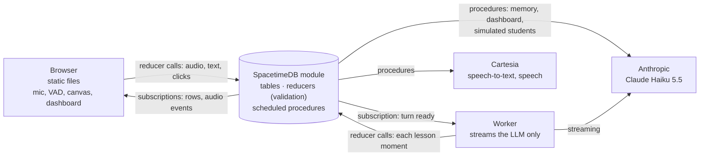

# Pitch: voice math tutor on SpacetimeDB

Material for the CalHacks judging (SpacetimeDB track). Spoken parts are in plain language; every
number has a source. The live demo script is [DEMO.md](DEMO.md); the full design is
[ARCHITECTURE.md](ARCHITECTURE.md).

---

## 1. Pitch

### 60 seconds

> Kids between 8 and 12 often get stuck on homework because they don't get the idea behind it.
> The arithmetic is usually fine. "Why is a quarter plus two quarters not three eighths?" A parent
> or a video can't always answer that question at the moment the child asks it.
>
> Our tutor talks with the child. The child says what they tried, by voice or by typing, and can add
> a photo of the task. The tutor explains with a picture that moves exactly when it says the
> matching words. It goes in the order teachers use: first an intuitive picture, then the notation,
> then a new task the child solves alone. At the end the child gets their own homework back. The
> tutor never solves it for them.
>
> Teachers can run a whole class with it. They type their goals and how they want the topic taught,
> and every student joins. On a dashboard the teacher sees a summary of the class and groups of
> students who are stuck the same way. They can click a student and watch their screen live.
>
> What's different is the backend: there isn't one, apart from a single SpacetimeDB module. State,
> speech-to-text, speech synthesis, memory, the dashboard and the checking of every AI output all
> run inside the database. The app is static files.

### 3 minutes

**Problem (30 s).**
> Children aged 8 to 12 get stuck on a concept, not on a calculation. When they add fractions they
> add the tops and the bottoms because nobody showed them what a quarter looks like. Help usually
> means the answer, which skips the understanding. Teachers have 25 kids and can't see who is stuck
> on what until the test.

**What it does: the student (60 s, live demo, left window).**
> Mia picks "learn by myself", types her task and starts talking. The tutor greets her right away
> (that line is written in advance, so it plays about half a second after the click). She says "I
> added the tops and the bottoms and got three eighths."
>
> Watch the canvas: the pieces appear when the tutor says the word. First a picture, then the
> equation shows up on the sentence that reads it, then a task with different numbers. If she gets it
> right she goes back to her homework. If she's unsure or wrong she gets one smaller step first. The
> tutor never gives her the answer to her own homework.
>
> She can interrupt the tutor mid-sentence, like a real conversation. Behind this are notes the tutor
> keeps about her (what she mixes up, what she's good at), so the next lesson starts where she is.

**What it does: the teacher (60 s, right window).**
> Ms. Park sets the goal: "add fractions with the same denominator", and how to teach it: "pictures
> first, short sentences". She starts a class. Every student who is online joins. For the demo we add
> six simulated students. Each one is played by Claude from a persona with typical mistakes, and
> they talk to the real tutor.
>
> Every 30 seconds the dashboard writes a class summary and puts students into groups of two or four
> ("adds the bottoms", "ready for a harder task"). The group sizes are checked in code, not left to
> the model. She hovers a student, clicks Observe, and sees that child's screen live.

**Why SpacetimeDB (30 s).**
> All of this is one SpacetimeDB module. Every screen (the child's, the teacher's, the observer) is
> a subscription to rows. Every AI output goes through a reducer that checks it before the child sees
> it. Speech, memory, simulated students and the dashboard are scheduled rows. The only other process
> streams the language model, because procedures can't stream yet. Our own overhead per voice turn is
> about 100 milliseconds. The rest is the speech and language services.

---

## 2. Why SpacetimeDB: talking points with evidence

| # | Claim | Evidence in the code | Source |
| --- | --- | --- | --- |
| 1 | **SpacetimeDB is the only data path. There is no backend server.** | Client and worker never talk to each other; both are SpacetimeDB clients. `pnpm build` produces `client/dist/`, pure static files (the Vite server was removed). API keys live only in module env, never in the client. | [ARCHITECTURE §1](ARCHITECTURE.md#1-the-rule-spacetimedb-is-the-only-data-path), NIGHT_REPORT row 4 |
| 2 | **Audio and speech synthesis happen inside the database.** | Mic audio goes up as `pushAudio` reducer calls (160 ms PCM chunks, 45 B overhead each) into the private `audio_in` table. The scheduled procedure `transcribePhrase` (`stt_job`) calls Cartesia STT. The scheduled procedure `synthesizeSentence` (`tts_job`) calls Cartesia `sonic-3.6` and writes the PCM plus word timestamps as one **event row** (`audio_out`) per sentence: delivered to subscribers at commit, never stored. Barge-in is a `playback_flush` event. | ARCHITECTURE §2 "Voice input/output", §10; `spacetimedb/src/voice_in.ts`, `voice_out.ts` |
| 3 | **Every view is a subscription, so observing a student cost no extra code path.** | The teacher's observe frame renders `<SessionView readOnly embedded />`: the same component with the same subscriptions as the student's own tab, minus inputs and audio. The dashboard, the overview and the worker are also just subscriptions. Fan-out to a second client: the observer gets rows at the same time as the student (observer caption p50 10.8 ms after play start). | ARCHITECTURE §9, §11; latency-internal.md "Downlink and render" |
| 4 | **Every LLM output is validated in a reducer.** | The worker proposes and the module decides. `beginLesson` checks the plan's schema, the allowed phases and repeated checks. `addBeat` **compiles each lesson moment against the live `canvas_state`** (version must match, at most 8 moments) before it inserts the `beat` and the sentences. A rejection is a `SenderError`; the worker gets one repair round, otherwise it closes with a recap. Cluster sizes (2 or 4) are repaired deterministically in code. Answer keys stay in private tables (`lesson_record`, `board_answer`). | ARCHITECTURE §6, §11; CLASSROOM.md "Validation + repair" |
| 5 | **Scheduled tables instead of queues.** | `stt_job`, `tts_job`, `text_play_job`, `extraction_job`, `summary_job`, `sim_turn_job`, `dashboard_job`. Retries are new rows, cancellation is a delete or a status check inside the job's transaction. No Redis, no cron, no queue service. | ARCHITECTURE §2 "Scheduled tables" |
| 6 | **Non-streaming AI runs in procedures too.** | Memory extraction, session summaries, simulated students and the dashboard call Claude Haiku 5.5 from module procedures over raw HTTP with structured outputs (`spacetimedb/src/anthropic.ts`). The HTTP call runs outside a transaction; the result is committed with `ctx.withTx`, which re-checks state. | ARCHITECTURE §8, §10 |
| 7 | **The worker exists only because procedures can't stream.** | `ctx.http.fetch` returns the whole response, so it can't read a token stream (async procedures: SpacetimeDB issue #4697). Streaming decides time-to-first-audio, so only that lives in the worker. The worker connects as a normal client registered as `agent` and holds no authority. | README "Why a worker exists", ARCHITECTURE §1 |
| 8 | **Private tables for what kids' clients must not see.** | Memory notes, evidence, mastery, raw audio, photos, answer keys, agent roles. Memory reaches the LLM only through agent-only procedures (`buildContext`, `buildLessonRequest`). | ARCHITECTURE §2 "Memory (all private)", §11 |

### Measured numbers (say them exactly like this)

All measured on 2026-10-24/25 on one MacBook against a **local** SpacetimeDB 2.13, mostly over a
phone hotspot. Not on Maincloud.

| Number | What exactly | Source |
| --- | --- | --- |
| **~8–15 ms** reducer round trip | `pushAudio` round trip p50 8.1 ms, p95 14.0 ms (n=300). Early spike: p50 9.2 ms / max 15 ms while a 3 s procedure was running. Client → SpacetimeDB → worker → SpacetimeDB → client: p50 14.2 ms | latency-internal.md "Upload transport"; README "First checks" #2, #6 |
| **~100 ms** own overhead per voice turn | From end of speech to first audio, the system adds p50 101 ms, p95 113 ms (n=12). The rest is the silence windows and external STT/TTS/LLM. **Measured with a fake LLM** so external time could be subtracted | latency-internal.md §2 |
| **~2.5–2.75 s** turn end → first audio | p50 2.5 s with the lesson planner when it was merged (4.3 s with the old tool loop). Final full E2E on the merged state with the two-minute arc: p50 2.75 s (min 2.62, max 3.17). Real Haiku 5.5 + Cartesia. One live turn: 2.77 s | README "Lesson pipeline"; NIGHT_REPORT "Test status"; README "STT decision" |
| **~0.5 s** click → first tutor audio | The opening is written in advance, no LLM (0.47 s). Final E2E measured "Start talking" → opening audio p50 1.06 s | README "Lesson pipeline"; NIGHT_REPORT |
| **0** rejected beats in E2E | Module beat rejections in the E2E runs after the lesson pipeline merge. Final E2E 8/8 pass | NIGHT_REPORT row 6, "Test status" |
| **8 simulated students → 64 turns in ~2 min** | n=8: every session reached the cap of 8 student turns + 9 tutor replies, 09:16:43 → 09:18:44. No rejected turns | CLASSROOM.md "Measured" |
| **Dashboard every 30 s** | 30 s after the previous run *finished*, so ~33–38 s in practice. One Haiku call, 3–10 s for 6–8 students, ≈ $0.0015 per refresh | CLASSROOM.md "Dashboard", "Measured" |
| Simulated student message | median 1.5 s, ≈ $0.00018 per message (112 calls) | CLASSROOM.md |
| Commit → subscriber | small rows ~7 ms; 165 KB audio row ~9 ms after commit | latency-internal.md "Downlink" |

Don't say "real time at scale", "production ready", or quote latency on Maincloud. We haven't
measured that.

---

## 3. Likely judge questions

**Q: How fast is it really?**
A: From the moment the child stops talking to the first tutor audio it takes about 2.5–2.75 s (p50,
real Haiku and Cartesia, local server). Our own code and SpacetimeDB add about 100 ms of that. Most
of the rest is the silence we wait for to know the child has finished (Smart Turn shortens it to
~0.6 s when the sentence is clearly complete), plus STT, the first LLM tokens and synthesis of the
first sentence. The next win would be streaming TTS of the first sentence, which a procedure can't
do today.

**Q: Does it scale?**
A: Honestly, we tested one laptop. Reducers are fast (~8 ms). The real limit is the procedure pool:
the local server runs about 10 procedures at once, and a procedure waiting on HTTP keeps its slot. With
4 parallel voice sessions, TTS jobs waited up to 0.7 s. We cap simulated-student calls at 4 in flight
and make one dashboard call per class. The fix we know of is limiting TTS look-ahead per reply.
Maincloud is supported by our publish script but we haven't migrated or measured it; every hop then
crosses the internet.

**Q: These are children. What about privacy?**
A: This is a hackathon prototype: test users only, no real children's data, no accounts, not
compliance-reviewed. In the design, everything sensitive is in **private tables** that no client can
subscribe to: memory notes, mastery, raw audio, photos, answer keys. Memory reaches the model only
through agent-only procedures. API keys are module env, never in tables or in the browser. Audio and
text do go to Cartesia and Anthropic. The local data directory holds the module env in plain bytes,
so it's never pushed.

**Q: Why Claude Haiku 5.5?**
A: Speed to the first useful token decides when the child hears something, and Haiku is fast and
cheap enough to run the tutor, the memory, 20 simulated students and the dashboard. We measured the
settings: thinking off is 0.3–0.5 s faster to the first token; for lessons, effort low had the same
latency as medium with fewer failures; for the dashboard, medium nearly doubled latency (mean 11.3 s
vs 6.9 s) without better groups. Structured outputs give us JSON from procedures without an SDK. OpenRouter is a
fallback.

**Q: What's AI and what's deterministic?**
A: AI: the tutor's lesson plan and wording (Haiku), speech-to-text and speech (Cartesia), memory
notes, simulated students, the dashboard summary and the *proposed* groups. Deterministic: whether a
lesson moment is valid on the current canvas, which phases are allowed next, grading of number,
choice and canvas answers (`assessResponse`, marked `source: deterministic`), group sizes, presence and
class transitions. The model proposes, reducers decide.

**Q: Why not just a Node backend with Postgres?**
A: We'd have to build what we got for free: live sync to every screen, the observer view, scheduled
jobs with retries, event streams for audio, and one place where every write is validated. Here every
screen is a subscription and every write is a reducer.

**Q: Why is there still a worker?**
A: Only for streaming the LLM. `ctx.http.fetch` returns the whole response, so a procedure can't read
tokens as they arrive. The worker is a normal SpacetimeDB client; every moment it streams is accepted
or rejected by the module. Once async procedures land (issue #4697) it can move into the module.

**Q: What if the model produces something wrong?**
A: Every lesson moment is compiled against the canvas the child is looking at. If it doesn't fit,
the reducer rejects it with a message; the worker gets one repair round before anything is spoken,
otherwise it stops and closes with a recap. In the E2E runs no beat was rejected. The math in the
spoken words is not formally checked. The dashboard can be wrong too: in our effort comparison it
occasionally put a student in a group without evidence.

**Q: Limitations?**
A:
- Tested locally on one machine, not on Maincloud, not with real children or real speakers
  (headphones recommended; echo can trigger barge-in).
- STT uses Cartesia's batch `ink-whisper`; the newer `ink-2` needs a websocket, so it only works
  through a proxy on a public host.
- The tutor's word budgets are prompted, and the model often goes over them (explanations 107–150
  words).
- The check that the task isn't the child's own homework is a substring match; a paraphrase passes.
- The dashboard for 8+ students takes 7–10 s per refresh.
- No accounts or auth.

---

## 4. Architecture (one slide)

Spoken caption: "Browser and worker only ever talk to SpacetimeDB. SpacetimeDB calls the speech and
language services itself. The worker streams the model and nothing else."

## Screenshots to show

`docs/screenshots/`: `11-student-voice-speaking.png` (avatar + canvas while speaking),
`12-student-text-lesson.png`, `24-dashboard-odd-class.png` (summary + groups of 2 and 4, Observe
button), `15-observe-frame.png` (observe = same view, read-only), `07-class-setup.png`.
Avoid `13-dashboard-clusters.png` and `13b-dashboard-clusters-full.png`: they were taken before
learner ids were stripped from the summary text ("Emma (31)"). That summary is still a good story
to tell, though: it caught the tutor stating answers outright against the teacher's "never give the
answer away" instruction.
